# Learn Neo4j 🕸️

<div align="center">

[](https://opensource.org/licenses/MIT)
[](https://neo4j.com/release-notes/)
[](https://github.com/TheLearningHubOrg/learn-neo4j/actions/workflows/ci.yml)
[](https://github.com/TheLearningHubOrg/learn-neo4j/releases)
[](https://neo4j.com/docs/cypher-manual/current/)
[](https://hub.docker.com/_/neo4j)

**From your first `MATCH` to staff-level graph modelling, query tuning and Neo4j operations.**  
The property graph model, Cypher 25, constraints and indexes, quantified path patterns and shortest paths, transactions and locking, drivers, import, clustering and the query planner.

[Getting Started](#1-stage-1-graph-model-architecture--first-queries) • [Modelling](#2-stage-2-data-modelling-writes--constraints) • [Querying](#3-stage-3-pattern-matching-aggregation-paths--indexes) • [Transactions](#4-stage-4-transactions-concurrency--locking) • [Applications](#5-stage-5-drivers-import-migrations--backup) • [Operations](#6-stage-6-clustering-scaling-tuning--observability) • [Interview Prep](#7-stage-7-staff-neo4j-engineer-interview-handbook--cheatsheet)

<br/>

<a href="https://www.buymeacoffee.com/manthanank">
  
</a>

</div>

---

**Language used in this guide.** Every example, the starter project and its tests are written in Cypher and run through `cypher-shell`, the client that ships with every Neo4j server. Cypher is the language the database executes: a driver in any language only sends Cypher strings and parameters over Bolt, so learning Cypher well is learning Neo4j. The one non-Cypher file is [`scripts/run-tests.sh`](scripts/run-tests.sh), a short Bash runner that loads the graph and checks the test results. Server settings appear as `neo4j.conf` lines or Docker environment variables. Where the guide shows application code (Stage 5), it uses Java first, because Neo4j runs on the JVM and the Java driver is the reference implementation, with Python, JavaScript and Go side by side where the drivers differ.

**Starter project.** [`cypher/`](cypher) builds a small developer-community graph (people, skills, projects and their dependencies) with constraints and indexes, and [`tests/`](tests) holds 39 self-checking Cypher tests. Stages 1-3 walk through it file by file.

```bash
# Option A: a throwaway server, with the repo mounted read-only
docker run -d --name neo4j -p 7474:7474 -p 7687:7687 \
  -e NEO4J_AUTH=neo4j/change-me-please -v "$PWD:/work:ro" neo4j:2026.10-community
docker exec -e NEO4J_PASSWORD=change-me-please neo4j bash /work/scripts/run-tests.sh

# Option B: build the image; the build runs the same tests and ships a seeded database
docker build -t learn-neo4j .
docker run -d --name devgraph -p 7474:7474 -p 7687:7687 \
  -e NEO4J_AUTH=neo4j/change-me-please learn-neo4j
docker exec -it devgraph cypher-shell -u neo4j -p change-me-please \
  "MATCH (p:Person)-[:WORKS_ON]->(pr:Project) RETURN pr.slug, collect(p.handle)"
```

---

## 🗺️ 7-Stage Pedagogical Roadmap

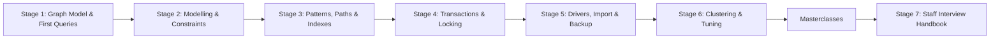

| Stage | Focus Domain | Core Concepts & Engineering Outcomes |
| :--- | :--- | :--- |
| **Stage 1** | **Graph Model, Architecture & First Queries** | Nodes, relationships, labels, types and properties; when a graph beats joins; DBMS vs database, Bolt (7687) and HTTP (7474), page cache, transaction log, index-free adjacency; `neo4j:2026.10-community` in Docker with `NEO4J_AUTH` and `NEO4J_server_*` settings; `cypher-shell`, Browser and the Query API (`POST /db/neo4j/query/v2`); `CREATE`, `MATCH`, `WHERE`, `RETURN`, `ORDER BY`. Outcome: run Neo4j locally and load the starter graph. |
| **Stage 2** | **Data Modelling, Writes & Constraints** | Property types, temporal values, `IS :: DATE` type predicates, why maps and `null` cannot be stored; node vs relationship vs property decisions, intermediate nodes; `MERGE` semantics and its traps; `SET`, `REMOVE`, `DETACH DELETE`; uniqueness constraints in Community, existence/type/key constraints in Enterprise; `UNWIND $rows`, `LOAD CSV`, `CALL { } IN TRANSACTIONS ... REPORT STATUS`; parameters and plan caching. Outcome: an idempotent seed that the database itself protects from duplicates. |
| **Stage 3** | **Pattern Matching, Aggregation, Paths & Indexes** | Trail semantics, `OPTIONAL MATCH`, implicit grouping keys, `collect`, `WITH` pipelines, `EXISTS { }`, `COUNT { }`, `COLLECT { }`, `CALL () { }`; quantified path patterns `-[:R]->+` and `{2}`; `SHORTEST k`, `shortestPath()`; friend-of-friend and relational-division queries; range, text, full-text and token lookup indexes; `EXPLAIN` and `PROFILE` with `NodeUniqueIndexSeek`, `Expand(All)` and `TriadicSelection`. Outcome: answer recommendation and dependency questions in one statement and read the plan that runs it. |
| **Stage 4** | **Transactions, Concurrency & Locking** | ACID in Neo4j, read-committed isolation, node and relationship write locks, deadlock detection and `TransientError` retries, `MERGE` under concurrency, explicit locking, `Eager` and memory limits, `SHOW TRANSACTIONS` and `TERMINATE TRANSACTIONS`. Outcome: concurrent writers that neither duplicate nor deadlock-crash. |
| **Stage 5** | **Drivers, Import, Migrations & Backup** | Bolt and `neo4j://` routing, the driver/session/transaction model, `executeQuery` vs managed transactions, bookmarks for causal consistency, connection pools; Java, Python, JavaScript and Go drivers; `neo4j-admin database import`, `LOAD CSV`; schema migrations; `neo4j-admin database dump/load` and online backup. Outcome: an application that talks to Neo4j safely and a restore you have tested. |
| **Stage 6** | **Clustering, Scaling, Tuning & Observability** | Primaries and secondaries, Raft, database topologies, server-side routing, composite databases; heap vs page cache sizing, `neo4j-admin server memory-recommendation`; query logging, metrics, `db.transaction.timeout`; capacity planning for supernodes. Outcome: a sized, observable deployment with a failover plan. |
| **Stage 7** | **Staff Neo4j Engineer Interview Handbook** | Staff-level questions on modelling trade-offs, internals, planner behaviour, consistency, clustering and incident scenarios, plus a dense cheatsheet. |

---

## 🆕 Neo4j Versions, What's New & Migration

Neo4j moved from semantic versions (4.4, 5.1 … 5.26) to calendar versions in January 2025. A release such as `2026.10.1` is the October 2026 release with its first patch. Calendar releases arrive roughly monthly and each one replaces the last; there is no separate "5.x" stream any more apart from the 5.26 long-term support line. The query language is versioned separately: a server accepts both **Cypher 5** and **Cypher 25**, and you choose per database or per query.

### V.1 Release Timeline

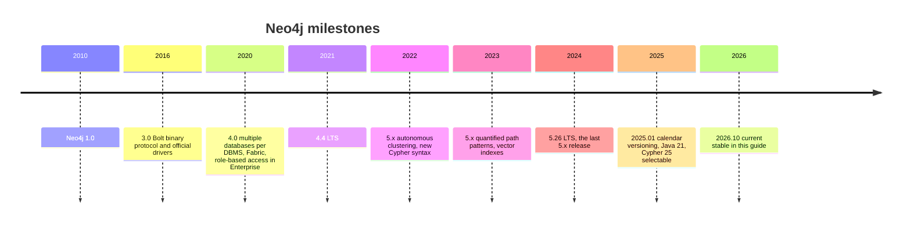

### V.2 Compatibility Matrix

| Server line | Java runtime | Default Cypher | Cypher versions accepted | Support model | Notes |
| :--- | :--- | :--- | :--- | :--- | :--- |
| 4.4 | 11 | Cypher 4.4 | 4.4 (plus 3.5 compatibility) | Old LTS | Plan a move off it; upgrades go 4.4 → 5.26 first. |
| 5.26 | 17 or 21 | Cypher 5 | 5 | Current LTS | Last semver release. Target for 4.4 upgrades. |
| 2025.x / 2026.x | 21 | Cypher 25 in the shipped `neo4j.conf` of current images (`db.query.default_language`) | 5 and 25 | Rolling: stay on a recent release | The Docker images in this guide report `db.query.default_language = CYPHER_25`. |

| Client | Works with 2026.x | How to pick a version |
| :--- | :--- | :--- |
| `cypher-shell` | The copy inside the server image or distribution | Always use the one shipped with the server. |
| Java driver (`org.neo4j.driver:neo4j-java-driver`) | 5.x and current stable | Use the current stable major; the drivers speak several Bolt versions and negotiate. |
| Python driver (`neo4j` on PyPI) | 5.x and current stable | The old `neo4j-driver` package name is deprecated; install `neo4j`. |
| JavaScript driver (`neo4j-driver` on npm) | 5.x and current stable | Same package for Node.js and browsers. |
| Go driver (`github.com/neo4j/neo4j-go-driver`) | v5 and current stable | Import path carries the major version. |
| .NET driver (`Neo4j.Driver`) | 5.x and current stable | Async API first. |

| Edition feature | Community | Enterprise |
| :--- | :--- | :--- |
| Databases per server | One user database (`neo4j`) plus `system` | Many, created with `CREATE DATABASE` |
| Constraints | Property uniqueness | Uniqueness, existence, property type, node and relationship keys |
| Clustering, online backup, RBAC beyond the built-in roles | No | Yes |
| Cypher runtimes | Slotted | Slotted, pipelined and parallel |
| Store format | Aligned record format | Block format (default for new Enterprise databases) and record formats |

### V.3 What's New in Neo4j 2026.x and Cypher 25

Every example below ran on `neo4j:2026.10-community`. Prefix a query with `CYPHER 25` or `CYPHER 5` to pin the language regardless of the database default.

**`FILTER` and `LET` as standalone clauses.** Cypher 5 needs `WITH ... WHERE` to filter between clauses and to name an expression.

```cypher
// Before (Cypher 5)
MATCH (p:Person)-[k:KNOWS]->(:Skill {name: 'Cypher'})
WITH p, k WHERE k.level >= 4
WITH p.handle + '@' + k.level AS tag
RETURN collect(tag) AS experts;

// After (Cypher 25)
CYPHER 25
MATCH (p:Person)-[k:KNOWS]->(:Skill {name: 'Cypher'})
FILTER k.level >= 4
LET tag = p.handle + '@' + k.level
RETURN collect(tag) AS experts;
```

`LET` keeps every variable already in scope, unlike `WITH`, which drops anything you do not list. One `LET` cannot see a variable defined earlier in the same clause: `LET x = 1, y = x + 1` fails with `42N62 ... Variable x not defined`; write two `LET` clauses instead.

**Conditional queries with `WHEN`.** Branching used to need `CALL` subqueries with `UNION` and filters.

```cypher
// Before (Cypher 5): both branches run, each filtered to its own case
WITH $handle AS h
CALL (h) {
  WITH h WHERE h IS NULL RETURN 'anonymous' AS who
  UNION
  WITH h WHERE h IS NOT NULL
  MATCH (p:Person {handle: h}) RETURN p.name AS who
}
RETURN who;

// After (Cypher 25): exactly one branch runs
CYPHER 25
WHEN $handle IS NULL THEN RETURN 'anonymous' AS who
ELSE MATCH (p:Person {handle: $handle}) RETURN p.name AS who
```

**Sequential composition with `NEXT`.** Each part of a `NEXT` chain sees only the columns the previous part returned, so long queries read as stages.

```cypher
CYPHER 25
MATCH (p:Person)-[:WORKS_ON]->(pr:Project)
RETURN pr.slug AS project, count(p) AS team
NEXT
FILTER team >= 2
RETURN collect(project) AS busy_projects
```

**Collection functions.** `coll.sort()`, `coll.distinct()` and friends replace `apoc.coll.*` for common list work, and the starter's tests rely on them.

```cypher
// Before: needed APOC or an UNWIND/collect round trip
UNWIND ['go', 'cypher', 'go'] AS x
WITH DISTINCT x ORDER BY x
RETURN collect(x) AS sorted;

// After (Cypher 25)
RETURN coll.sort(coll.distinct(['go', 'cypher', 'go'])) AS sorted
```

**A `VECTOR` value type and a `SEARCH` clause for vector indexes.** Embeddings used to be plain `LIST<FLOAT>` properties queried through a procedure.

```cypher
// Before (Cypher 5): procedure call
CALL db.index.vector.queryNodes('doc_embedding', 5, $queryVector)
YIELD node, score
RETURN node.title, score;

// After (Cypher 25): a clause that composes with MATCH
CYPHER 25
MATCH (d:Doc)
  SEARCH d IN (VECTOR INDEX doc_embedding FOR $queryVector LIMIT 5)
RETURN d.title
```

`vector([1.0, 2.0], 2, FLOAT32)` builds a typed vector value. Masterclass material later in the guide covers vector search end to end.

**Stricter clause order.** In Cypher 25 `OFFSET` is a synonym for `SKIP`, and `ORDER BY`, `SKIP`/`OFFSET`, `LIMIT` must appear in that order. `RETURN x LIMIT 1 SKIP 1` fails with `42I63 ... wrong subclause order`.

**Features from late 5.x that are now everyday Cypher** (all available in 5.26 and 2026.x):

| Feature | Old way | Current way |
| :--- | :--- | :--- |
| Variable-length patterns | `(a)-[:R*1..5]->(b)` | Quantified path patterns: `(a)-[:R]->{1,5}(b)`, `(a)((x)-[:R]->(y) WHERE y.ok){1,5}(b)` |
| Shortest paths | `shortestPath((a)-[:R*]->(b))` | `MATCH p = SHORTEST 1 (a)-[:R]->+(b)`, also `ALL SHORTEST`, `SHORTEST 3 GROUPS` |
| Subquery imports | `CALL { WITH x ... }` | `CALL (x) { ... }` and `CALL () { ... }` |
| Dynamic labels | APOC or string-built queries | `SET n:$($label)`, `MATCH (n:$($label))`, `CREATE (n:$(['A','B']))` |
| Existence checks | `exists((a)-->())`, `size((a)-->())` | `EXISTS { (a)-->() }`, `COUNT { (a)-->() }` |
| Type checks | `apoc.meta.type()` | `x IS :: INTEGER NOT NULL` |
| Element ids | `id(n)` (deprecated) | `elementId(n)` |
| Error reporting | Neo4j status codes only | GQL status codes such as `22N80` and `42N62` alongside the classic codes |

### V.4 Migration Guide

**5.26 LTS → 2026.x.** Calendar releases can be reached directly from 5.26.

1. Upgrade the Java runtime to 21 if you use the tarball or packages. Docker images bundle their own JVM.
2. Run your workload's queries with `EXPLAIN` under `CYPHER 25` and collect the deprecation notifications:

   ```cypher
   CYPHER 25 EXPLAIN MATCH (p:Person) RETURN id(p);
   ```

   The deprecations come back as notifications on the result summary, not as errors: Neo4j Browser shows them as warnings, and the drivers expose them (`ResultSummary.gqlStatusObjects()` in Java, `summary.gql_status_objects` in Python). Log them from a test run of your query suite.
3. Keep production on `db.query.default_language=CYPHER_5` until the queries pass, then flip the setting per database:

   ```cypher
   // Enterprise: per database
   ALTER DATABASE neo4j SET DEFAULT LANGUAGE CYPHER 25;
   ```

   In Community, set `db.query.default_language=CYPHER_5` or `CYPHER_25` in `neo4j.conf`. Individual queries can always override it with a `CYPHER 5` or `CYPHER 25` prefix.
4. Take a backup, stop the server, replace the binaries or image tag, and start it. Within the same store format the store is upgraded when the database starts. To change format, or to run the migration as a separate, observable step, use `neo4j-admin` with the database stopped:

   ```bash
   neo4j-admin database migrate neo4j --to-format=block   # Enterprise: switch store format
   neo4j-admin database migrate neo4j                     # same format, newer version
   ```

5. Upgrade drivers to the current stable major after the server, then remove deprecated driver calls the compiler or linter flags.

**4.4 → 5.26.** Not direct to calendar releases. Upgrade the drivers to 5.x first (they speak to 4.4 too), then dump each database on 4.4, load it on 5.26 and migrate it:

```bash
# On 4.4
neo4j-admin dump --database=neo4j --to=/backups/neo4j.dump
# On 5.26
neo4j-admin database load neo4j --from-path=/backups --overwrite-destination=true
neo4j-admin database migrate neo4j --force-btree-indexes-to-range
```

BTREE indexes no longer exist in 5.x; the migrate flag above recreates them as RANGE indexes. Recreate any full-text analyzers or point indexes the migration reports.

### V.5 Deprecations & Breaking Changes

| Change | Since | Replacement |
| :--- | :--- | :--- |
| `id()` deprecated | 5.0 | `elementId()`; never store either as a business key |
| `exists(n.prop)` function removed | 5.0 | `n.prop IS NOT NULL` |
| Pattern expressions as values, `size((n)-->())` | 5.0 | `COUNT { (n)-->() }`, pattern comprehension `[(n)-->(m) \| m]` |
| BTREE indexes removed | 5.0 | RANGE, TEXT and POINT indexes |
| `CALL { WITH x ... }` importing `WITH` | deprecated in 5.x | `CALL (x) { ... }` |
| `shortestPath()` / `allShortestPaths()` | still accepted; `SHORTEST` preferred | `SHORTEST k`, `ALL SHORTEST` |
| Semantic version numbers | after 5.26 | Calendar versions `YYYY.MM.patch` |
| Java 17 on the server | 2025.01 | Java 21 |
| `neo4j-driver` Python package name | 5.x | `neo4j` |
| Default Cypher version | current images ship `CYPHER_25` in `neo4j.conf` | Pin with `CYPHER 5` while you migrate |
| `ORDER BY` / `SKIP` / `LIMIT` in any order | Cypher 25 | Write them in that order; `OFFSET` is accepted for `SKIP` |

---

## 📋 Table of Contents

- [🆕 Neo4j Versions, What's New & Migration](#-neo4j-versions-whats-new--migration)
  - [V.1 Release Timeline](#v1-release-timeline)
  - [V.2 Compatibility Matrix](#v2-compatibility-matrix)
  - [V.3 What's New in Neo4j 2026.x and Cypher 25](#v3-whats-new-in-neo4j-2026x-and-cypher-25)
  - [V.4 Migration Guide](#v4-migration-guide)
  - [V.5 Deprecations & Breaking Changes](#v5-deprecations--breaking-changes)
- [1. Stage 1: Graph Model, Architecture & First Queries](#1-stage-1-graph-model-architecture--first-queries)
  - [1.1 The Property Graph Model](#11-the-property-graph-model)
  - [1.2 When a Graph Database Fits](#12-when-a-graph-database-fits)
  - [1.3 Server Architecture](#13-server-architecture)
  - [1.4 Index-Free Adjacency and the Store Files](#14-index-free-adjacency-and-the-store-files)
  - [1.5 Running Neo4j in Docker](#15-running-neo4j-in-docker)
  - [1.6 The Three Clients: cypher-shell, Browser and the Query API](#16-the-three-clients-cypher-shell-browser-and-the-query-api)
  - [1.7 First Cypher Queries](#17-first-cypher-queries)
  - [1.8 How Cypher Executes: Rows Flow Through Clauses](#18-how-cypher-executes-rows-flow-through-clauses)
  - [1.9 Running the Starter Project](#19-running-the-starter-project)
  - [1.10 Pitfalls](#110-pitfalls)
  - [1.11 Best Practices](#111-best-practices)
  - [1.12 Hands-on Exercise](#112-hands-on-exercise)
- [2. Stage 2: Data Modelling, Writes & Constraints](#2-stage-2-data-modelling-writes--constraints)
  - [2.1 Property Types and the Type System](#21-property-types-and-the-type-system)
  - [2.2 Node, Relationship or Property?](#22-node-relationship-or-property)
  - [2.3 Intermediate Nodes and Other Modelling Patterns](#23-intermediate-nodes-and-other-modelling-patterns)
  - [2.4 The Starter Model](#24-the-starter-model)
  - [2.5 Writing: CREATE, SET, REMOVE and DELETE](#25-writing-create-set-remove-and-delete)
  - [2.6 MERGE in Depth](#26-merge-in-depth)
  - [2.7 Constraints and Editions](#27-constraints-and-editions)
  - [2.8 Batch Loading: UNWIND, LOAD CSV and CALL IN TRANSACTIONS](#28-batch-loading-unwind-load-csv-and-call-in-transactions)
  - [2.9 Parameters, Plan Caching and Injection](#29-parameters-plan-caching-and-injection)
  - [2.10 Refactoring a Live Graph](#210-refactoring-a-live-graph)
  - [2.11 Pitfalls](#211-pitfalls)
  - [2.12 Best Practices](#212-best-practices)
  - [2.13 Hands-on Exercise](#213-hands-on-exercise)
- [3. Stage 3: Pattern Matching, Aggregation, Paths & Indexes](#3-stage-3-pattern-matching-aggregation-paths--indexes)
  - [3.1 Pattern Matching Semantics](#31-pattern-matching-semantics)
  - [3.2 OPTIONAL MATCH and null](#32-optional-match-and-null)
  - [3.3 Aggregation and Grouping Keys](#33-aggregation-and-grouping-keys)
  - [3.4 WITH, UNWIND, Lists and CASE](#34-with-unwind-lists-and-case)
  - [3.5 Subqueries: EXISTS, COUNT, COLLECT and CALL](#35-subqueries-exists-count-collect-and-call)
  - [3.6 Variable-Length Paths and Quantified Path Patterns](#36-variable-length-paths-and-quantified-path-patterns)
  - [3.7 Shortest Paths](#37-shortest-paths)
  - [3.8 Recommendation and Relational-Division Queries](#38-recommendation-and-relational-division-queries)
  - [3.9 Indexes: Kinds and How to Choose](#39-indexes-kinds-and-how-to-choose)
  - [3.10 Reading Plans with EXPLAIN and PROFILE](#310-reading-plans-with-explain-and-profile)
  - [3.11 Pitfalls](#311-pitfalls)
  - [3.12 Best Practices](#312-best-practices)
  - [3.13 Hands-on Exercise](#313-hands-on-exercise)
- [4. Stage 4: Transactions, Concurrency & Locking](#4-stage-4-transactions-concurrency--locking)
  - [4.1 Transactions in Neo4j](#41-transactions-in-neo4j)
  - [4.2 Isolation Level and Read Phenomena](#42-isolation-level-and-read-phenomena)
  - [4.3 Deadlocks and Transient Errors](#43-deadlocks-and-transient-errors)
  - [4.4 Lost Updates and Explicit Locks](#44-lost-updates-and-explicit-locks)
  - [4.5 Eager Operators, Memory and Timeouts](#45-eager-operators-memory-and-timeouts)
  - [4.6 Observing and Terminating Transactions](#46-observing-and-terminating-transactions)
  - [4.7 Pitfalls](#47-pitfalls)
  - [4.8 Best Practices](#48-best-practices)
  - [4.9 Hands-on Exercise](#49-hands-on-exercise)
- [5. Stage 5: Drivers, Import, Migrations & Backup](#5-stage-5-drivers-import-migrations--backup)
  - [5.1 The Driver Model](#51-the-driver-model)
  - [5.2 Java Driver](#52-java-driver)
  - [5.3 The Same Query in Python, JavaScript and Go](#53-the-same-query-in-python-javascript-and-go)
  - [5.4 Bulk Import](#54-bulk-import)
  - [5.5 Schema Migrations](#55-schema-migrations)
  - [5.6 Backup and Restore](#56-backup-and-restore)
  - [5.7 Pitfalls](#57-pitfalls)
  - [5.8 Best Practices](#58-best-practices)
  - [5.9 Hands-on Exercise](#59-hands-on-exercise)
- [6. Stage 6: Clustering, Scaling, Tuning & Observability](#6-stage-6-clustering-scaling-tuning--observability)
  - [6.1 Clustering Model](#61-clustering-model)
  - [6.2 Causal Consistency and Routing](#62-causal-consistency-and-routing)
  - [6.3 Scaling Out: Composite Databases](#63-scaling-out-composite-databases)
  - [6.4 Memory Sizing](#64-memory-sizing)
  - [6.5 Observability](#65-observability)
  - [6.6 Supernodes and Data Growth](#66-supernodes-and-data-growth)
  - [6.7 Pitfalls](#67-pitfalls)
  - [6.8 Best Practices](#68-best-practices)
  - [6.9 Hands-on Exercise](#69-hands-on-exercise)
- [7. Stage 7: Staff Neo4j Engineer Interview Handbook & Cheatsheet](#7-stage-7-staff-neo4j-engineer-interview-handbook--cheatsheet)
  - [7.1 Core Concepts (Q1-Q10)](#71-core-concepts-q1-q10)
  - [7.5 Staff Cheatsheet](#75-staff-cheatsheet)
- [🧪 Example Projects](#-example-projects)
- [📝 Cheat Sheets](#-cheat-sheets)
- [📚 Resources](#-resources)
- [🤝 Contributing](#-contributing)
- [📄 License](#-license)
- [🙏 Acknowledgments](#-acknowledgments)
- [🌐 Connect with me](#-connect-with-me)
- [☕ Support](#-support)

---

## 1. Stage 1: Graph Model, Architecture & First Queries

This stage builds the mental model: what a property graph is, how Neo4j stores and serves it, and how a Cypher query turns a picture of a pattern into rows. Prerequisites: Docker and a terminal; no graph experience needed. Afterwards you can run Neo4j locally, connect with three different clients, load the starter graph and write read queries against it.

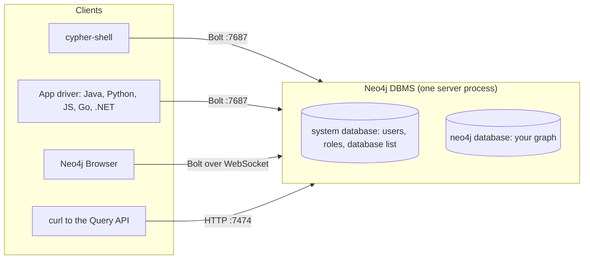

### 1.1 The Property Graph Model

A property graph has two kinds of element and two ways of describing them:

| Element | What it is | Described by | Starter example |
| :--- | :--- | :--- | :--- |
| Node | An entity | Zero or more **labels** plus properties | `(:Person {handle: 'ada', city: 'London'})` |
| Relationship | A directed, typed connection between exactly two nodes | Exactly one **type** plus properties | `(ada)-[:WORKS_ON {role: 'lead', since: 2022}]->(gateway)` |
| Label | A tag that groups nodes; a node can have several | Name, by convention `UpperCamelCase` | `Person`, `Skill`, `Project` |
| Relationship type | The meaning of a connection | Name, by convention `UPPER_SNAKE_CASE` | `FOLLOWS`, `KNOWS`, `WORKS_ON`, `DEPENDS_ON`, `USES` |
| Property | A key-value pair on a node or relationship | Key is `lowerCamelCase`; value is a scalar, temporal, spatial value or a homogeneous list | `joined: date('2021-03-14')`, `level: 5` |

There is no schema that every node must follow. Two `Person` nodes may carry different property keys, and a node may have no labels at all. Structure comes from constraints and indexes, which you add in Stage 2, and from the discipline of your writes.

A relationship always has a direction and always connects two existing nodes. You can ignore the direction when you query (`(a)-[:FOLLOWS]-(b)`), so model it in the direction that reads naturally and do not add a reverse relationship "for speed": traversal works in both directions at the same cost.

Here is a slice of the starter graph:

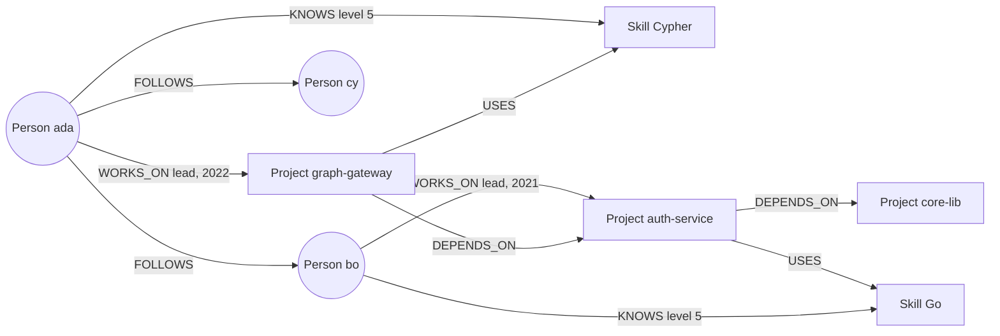

The full model is in [`cypher/01_seed.cypher`](cypher/01_seed.cypher): 8 people, 6 skills, 6 projects and 52 relationships.

### 1.2 When a Graph Database Fits

A relational database answers "which rows match" well. A graph database answers "what is connected to this, and how" well. The difference shows up when the number of hops is large, variable or unknown in advance.

| Question | Relational shape | Graph shape |
| :--- | :--- | :--- |
| Who does ada follow? | One join on a `follows` table | One hop from one node |
| Friends of friends ada does not follow yet | Self-join twice, then an anti-join | `(me)-[:FOLLOWS]->()-[:FOLLOWS]->(fof) WHERE NOT (me)-[:FOLLOWS]->(fof)` |
| Everything `graph-gateway` depends on, at any depth | Recursive CTE | `(:Project {slug: 'graph-gateway'})-[:DEPENDS_ON]->+(dep)` |
| Shortest chain of follows between two people | Recursive CTE with path tracking and cycle checks | `SHORTEST 1 (a)-[:FOLLOWS]->+(b)` |
| Monthly revenue per country | `GROUP BY` over a fact table | Possible, but a columnar or relational store does this better |

The same friend-of-friend question in SQL and Cypher:

```sql
-- SQL: follows(follower_id, followee_id)
SELECT f2.followee_id AS candidate, count(DISTINCT f1.followee_id) AS mutual
FROM follows f1
JOIN follows f2 ON f2.follower_id = f1.followee_id
WHERE f1.follower_id = :me
  AND f2.followee_id <> :me
  AND NOT EXISTS (SELECT 1 FROM follows x
                  WHERE x.follower_id = :me AND x.followee_id = f2.followee_id)
GROUP BY f2.followee_id
ORDER BY mutual DESC;
```

```cypher
MATCH (me:Person {handle: $me})-[:FOLLOWS]->(friend)-[:FOLLOWS]->(fof:Person)
WHERE fof <> me AND NOT (me)-[:FOLLOWS]->(fof)
RETURN fof.handle AS candidate, count(DISTINCT friend) AS mutual
ORDER BY mutual DESC;
```

The SQL version joins through an index on `follows` once per hop; each join looks up keys in a B-tree whose depth grows with the table. The Cypher version starts at one node found by an index and then follows stored pointers from node to relationship to node. The work grows with the number of relationships it touches, not with the size of the whole graph. Section 1.4 shows why.

Choose Neo4j when relationships are first-class data that you query by walking them: recommendations, fraud rings, network and dependency analysis, identity and access graphs, knowledge graphs and GraphRAG. Keep a relational or analytical store for wide aggregations over many rows with few relationships.

### 1.3 Server Architecture

One Neo4j server process is a **DBMS**. It hosts a `system` database (users, roles, privileges, the list of databases) and one or more user databases. Community Edition allows one user database, named `neo4j` by default; Enterprise can create many.

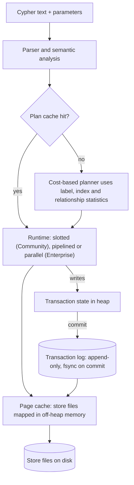

| Component | Role | Setting you will touch |
| :--- | :--- | :--- |
| Bolt connector | Binary protocol for drivers, `cypher-shell` and Browser, port 7687 | `server.bolt.listen_address` |
| HTTP connector | Query API, Browser files, discovery document, port 7474 | `server.http.listen_address` |
| Planner | Turns Cypher into an operator tree using statistics; plans are cached by query text | `server.memory.query_cache.per_db_cache_num_entries` |
| Runtime | Executes the plan. Community runs the slotted runtime | `CYPHER runtime=slotted` hint |
| Heap | Transaction state, query working memory, plan cache | `server.memory.heap.initial_size`, `server.memory.heap.max_size` |
| Page cache | Off-heap cache of store and index files; ideally holds the whole store | `server.memory.pagecache.size` |
| Transaction log | Durable record of every committed change; replayed after a crash | `db.tx_log.rotation.retention_policy` |
| Checkpointer | Flushes dirty pages so old log files can be pruned | `db.checkpoint.interval.time` |

A commit is durable once its entry is flushed to the transaction log; the store files are brought up to date later by checkpoints. After a crash, recovery replays the log from the last checkpoint.

### 1.4 Index-Free Adjacency and the Store Files

"Index-free adjacency" means a node knows where its relationships are. Neo4j does not look up "relationships of node 42" in a global index during a traversal; it follows a pointer from the node to its relationships and from a relationship to the node at the other end.

In the record store format (the format Community Edition uses), records have a fixed size, so the record with id N sits at byte offset `N × record size` in its file:

| Store file | Record | Size | Holds |
| :--- | :--- | :--- | :--- |
| `neostore.nodestore.db` | Node | 15 bytes | In-use flag, id of the first relationship, id of the first property, label field |
| `neostore.relationshipstore.db` | Relationship | 34 bytes | Start node, end node, type, and the previous and next relationship for **both** end nodes |
| `neostore.propertystore.db` | Property | 41 bytes | Up to four property blocks, plus pointers to the previous and next property record |
| `neostore.propertystore.db.strings` / `.arrays` | Dynamic | Variable | Values too large for a property block |

Each node's relationships form a doubly linked chain through the relationship records:

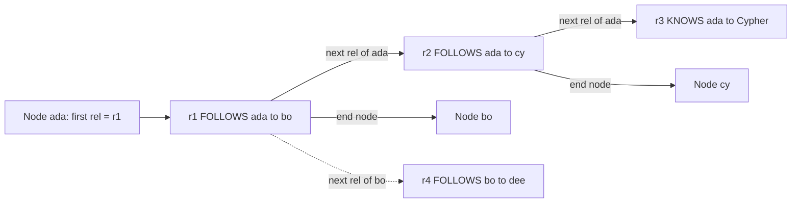

Consequences you can use:

- Expanding from a node costs time proportional to that node's degree, independent of how many nodes the database holds.
- Nodes with many relationships (thousands or millions, "supernodes") get split into **relationship groups** per type and direction, so `(n)-[:FOLLOWS]->()` does not walk past `KNOWS` relationships. Model so that hot queries filter by type and direction.
- Finding the **starting** nodes is not index-free. `MATCH (p:Person {handle: 'ada'})` needs an index (or a label scan) to find ada. Constraints and indexes, from Stage 2 and 3, make that first step cheap.

Enterprise Edition also offers the **block format**, which co-locates a node with its properties and a small number of relationships in 128-byte blocks to cut page cache misses. The idea is the same: data that is traversed together is stored together.

### 1.5 Running Neo4j in Docker

The official image runs the server as the `neo4j` user and reads configuration from environment variables.

```bash
docker run -d --name neo4j \
  -p 7474:7474 -p 7687:7687 \
  -e NEO4J_AUTH=neo4j/change-me-please \
  -e NEO4J_server_memory_heap_max__size=1G \
  -e NEO4J_server_memory_pagecache_size=512M \
  -v neo4j-data:/data \
  -v neo4j-logs:/logs \
  neo4j:2026.10-community

docker logs -f neo4j      # wait for "Started."
```

| Line | Role | What happens at runtime |
| :--- | :--- | :--- |
| `-p 7474:7474 -p 7687:7687` | Publish HTTP and Bolt | Browser at `http://localhost:7474`, drivers at `neo4j://localhost:7687` |
| `NEO4J_AUTH=neo4j/<password>` | Initial password for the `neo4j` user | Applied only when `/data` is empty. Passwords need at least 8 characters. `NEO4J_AUTH=none` disables auth for local experiments |
| `NEO4J_server_memory_heap_max__size=1G` | Any `neo4j.conf` setting | The entrypoint maps `NEO4J_` + name, with `.` written as `_` and `_` written as `__`: this becomes `server.memory.heap.max_size=1G` |
| `-v neo4j-data:/data` | Persistent store, transaction logs and `system` database | Without a volume the graph disappears with the container |
| `-v neo4j-logs:/logs` | `neo4j.log`, `debug.log`, query log (Enterprise) | Keep them for troubleshooting |
| `neo4j:2026.10-community` | Pin the release line | `2026.10` follows patch releases; `2026.10.1` pins exactly. Avoid `latest` in anything you deploy |

Settings you will meet early:

```properties
# neo4j.conf (or the NEO4J_ variables above)
server.default_listen_address=0.0.0.0
server.memory.heap.initial_size=1G
server.memory.heap.max_size=1G
server.memory.pagecache.size=512M
db.query.default_language=CYPHER_25
db.transaction.timeout=30s
```

The startup sequence explains why the first connection sometimes fails:

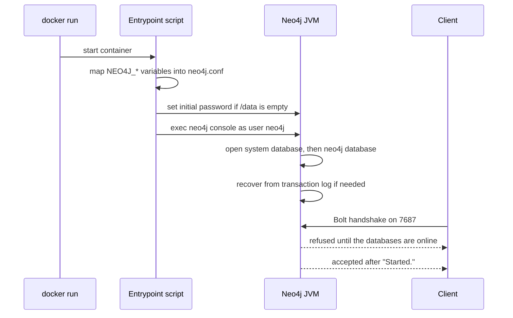

### 1.6 The Three Clients: cypher-shell, Browser and the Query API

**`cypher-shell`** ships inside the server image and distribution. It is the right tool for scripts, CI and runbooks.

```bash
# Interactive
docker exec -it neo4j cypher-shell -u neo4j -p change-me-please

# One statement, machine-friendly output
docker exec neo4j cypher-shell -u neo4j -p change-me-please --format plain \
  "MATCH (n) RETURN count(n) AS nodes"

# A file of statements separated by semicolons; stops at the first error
docker exec neo4j cypher-shell -u neo4j -p change-me-please --file /work/cypher/00_schema.cypher

# Parameters
docker exec neo4j cypher-shell -u neo4j -p change-me-please \
  --param 'handle => "ada"' "MATCH (p:Person {handle: \$handle}) RETURN p.name"
```

Inside an interactive session, commands start with a colon: `:help`, `:param handle => 'ada'`, `:params`, `:begin` / `:commit` / `:rollback` for an explicit transaction, `:use system` to switch database, `:exit`.

**Neo4j Browser** is served at `http://localhost:7474/browser/`. It draws node-link results, shows the plan of `EXPLAIN`/`PROFILE` queries and surfaces warnings such as Cartesian products and deprecations. Use it for exploration, not for automation.

**The Query API** is a JSON-over-HTTP endpoint for environments that cannot use Bolt:

```bash
curl -s -u neo4j:change-me-please \
  -H 'Content-Type: application/json' \
  -d '{"statement": "MATCH (p:Person {handle: $h}) RETURN p.name AS name",
       "parameters": {"h": "ada"}}' \
  http://localhost:7474/db/neo4j/query/v2
```

```json
{"data": {"fields": ["name"], "values": [["Ada Okafor"]]}, "queryType": "r",
 "resultAvailableAfter": 4, "resultConsumedAfter": 5, "bookmarks": ["FB:kcwQ..."]}
```

The starter's CI uses exactly this call to prove the Docker image is seeded. Applications should prefer the drivers (Stage 5): they pool connections, retry transient errors and route in clusters.

| Client | Protocol | Best for | Not for |
| :--- | :--- | :--- | :--- |
| `cypher-shell` | Bolt | Scripts, CI, migrations, admin | Visual exploration |
| Browser | Bolt over WebSocket | Learning, exploring, reading plans | Automation |
| Query API | HTTPS + JSON | Serverless functions, languages without a driver, quick checks | High-throughput apps |
| Drivers | Bolt | Applications | One-off admin |

### 1.7 First Cypher Queries

Cypher describes patterns with ASCII art: `()` is a node, `-[]->` a relationship, `:Label` and `:TYPE` restrict them, and `{key: value}` matches properties.

```cypher
// Create a node and return it
CREATE (p:Person {handle: 'zoe', name: 'Zoe Ito', city: 'Kyoto', joined: date()})
RETURN p;

// Find it again by label and property
MATCH (p:Person {handle: 'zoe'})
RETURN p.name, p.city;

// The same filter written with WHERE, which allows any expression
MATCH (p:Person)
WHERE p.city IN ['London', 'Kyoto'] AND p.joined >= date('2023-01-01')
RETURN p.handle, p.joined
ORDER BY p.joined DESC;

// Connect two existing nodes
MATCH (z:Person {handle: 'zoe'}), (a:Person {handle: 'ada'})
CREATE (z)-[:FOLLOWS]->(a);

// Read a pattern: who does zoe follow, and what do they know?
MATCH (:Person {handle: 'zoe'})-[:FOLLOWS]->(f:Person)-[k:KNOWS]->(s:Skill)
RETURN f.handle, s.name, k.level
ORDER BY k.level DESC;

// Clean up: a node with relationships needs DETACH DELETE
MATCH (p:Person {handle: 'zoe'})
DETACH DELETE p;
```

| Clause | Role | What happens at runtime |
| :--- | :--- | :--- |
| `CREATE` | Writes the pattern exactly as written, every time | Running it twice creates two `zoe` nodes unless a constraint stops it (Stage 2) |
| `MATCH` | Finds every way the pattern exists in the graph | Produces one row per match; zero matches means zero rows and the rest of the query does nothing |
| `WHERE` | Filters the rows of the preceding `MATCH` | Also feeds the planner: equality on an indexed property becomes an index seek |
| `RETURN` | Projects columns | Aggregates here group by the non-aggregated columns |
| `ORDER BY`, `SKIP`/`OFFSET`, `LIMIT` | Sort and page | Must appear in this order in Cypher 25 |
| `DETACH DELETE` | Deletes a node and its relationships | Plain `DELETE` on a connected node fails with `G1001: dependent object error - edges still exist` |

Run the same reads against the starter graph:

```cypher
// Who works on graph-gateway, and in which role?
MATCH (p:Person)-[w:WORKS_ON]->(:Project {slug: 'graph-gateway'})
RETURN p.handle, w.role, w.since
ORDER BY w.since;
```

```text
p.handle, w.role, w.since
"ada", "lead", 2022
"bo", "contributor", 2023
"hal", "contributor", 2024
```

### 1.8 How Cypher Executes: Rows Flow Through Clauses

A Cypher query is a pipeline. Each clause takes a table of rows (variables bound to values) and produces a new table. `MATCH` multiplies rows, `WHERE` removes them, `WITH` and `RETURN` project and aggregate.

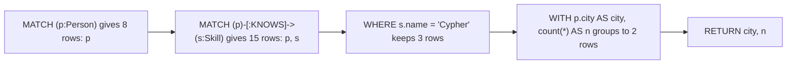

```cypher
MATCH (p:Person)
MATCH (p)-[:KNOWS]->(s:Skill)
WHERE s.name = 'Cypher'
WITH p.city AS city, count(*) AS n
RETURN city, n
ORDER BY n DESC, city;
```

```text
city, n
"London", 2
"Lyon", 1
```

Three rules follow from the row model:

1. **A `MATCH` that finds nothing ends the query for that row.** If ada had no `KNOWS` relationships she would vanish from the second step. `OPTIONAL MATCH` (Stage 3) keeps the row and binds `null` instead.
2. **Patterns in one `MATCH` with no shared variable produce a Cartesian product.** `MATCH (a:Person), (s:Skill)` yields 8 × 6 = 48 rows. Sometimes intended, usually a bug.
3. **`WITH` is a boundary.** Only the variables you list survive it. It is where you aggregate mid-query, filter on an aggregate, or limit before an expensive expansion.

### 1.9 Running the Starter Project

The starter lives in three folders:

```text
cypher/00_schema.cypher        constraints and indexes, IF NOT EXISTS everywhere
cypher/01_seed.cypher          the developer-community graph, written with MERGE
tests/01_schema_test.cypher    the schema objects exist and are ONLINE
tests/02_data_test.cypher      shape of the data, MERGE idempotency, rejected duplicates
tests/03_queries_test.cypher   exact answers for the Stage 3 queries
scripts/run-tests.sh           loads cypher/ into an empty database and runs tests/
exercises/                     solutions to the hands-on exercises
```

Every test statement returns one row with two columns, `test` and `ok`:

```cypher
MATCH (p:Person)-[:KNOWS]->(s:Skill)
WITH s.name AS skill, count(p) AS people
ORDER BY people DESC, skill
WITH collect(skill + ':' + people) AS got
RETURN 'people per skill, most common first' AS test,
       got = ['Cypher:3', 'Go:3', 'Python:3', 'Java:2', 'Kubernetes:2', 'Rust:2'] AS ok;
```

The runner, [`scripts/run-tests.sh`](scripts/run-tests.sh), in detail:

| Step | Code | Why |
| :--- | :--- | :--- |
| Credentials | `export NEO4J_USERNAME NEO4J_PASSWORD` | `cypher-shell` reads them from the environment, so the password is not visible in `ps` output |
| Safety check | `MATCH (n) RETURN count(n)` must be `0` unless `RESET=1` | The runner never wipes a database by accident |
| Reset | `MATCH (n) CALL (n) { DETACH DELETE n } IN TRANSACTIONS OF 1000 ROWS` | Deletes in batches so a big graph does not need one huge transaction |
| Load | `cypher-shell --file cypher/NN_*.cypher` in name order | Schema before data, so `MERGE` uses the constraint indexes |
| Count expected | `grep -c 'AS ok;$'` per test file | A query that returns no row is a failure, not a silent pass |
| Check | Every output row must end in `, TRUE` | `--format plain` prints booleans as `TRUE` / `FALSE` |

```bash
docker exec -e NEO4J_PASSWORD=change-me-please neo4j bash /work/scripts/run-tests.sh
```

```text
== apply cypher/00_schema.cypher
== apply cypher/01_seed.cypher
== tests/01_schema_test.cypher
ok   three uniqueness constraints exist
...
== tests/03_queries_test.cypher
ok   friend-of-friend recommendations for ada
...
39 passed, 0 failed
```

The Dockerfile's `verify` stage runs the same script during `docker build`, then copies the seeded `neo4j` store into the runtime image. Only the user database is copied: the `system` database, which holds the password, is created fresh from `NEO4J_AUTH` the first time the container starts.

### 1.10 Pitfalls

| Pitfall | Symptom | Fix |
| :--- | :--- | :--- |
| Connecting before the server is ready | `Unable to connect to localhost:7687, ensure the database is running` right after `docker run` | Poll with `cypher-shell 'RETURN 1'` or wait for `Started.` in the log, as the CI workflow does |
| `NEO4J_AUTH` ignored after the first start | The new password is rejected; the old one still works | The password is stored in the `system` database on the volume. Change it with `ALTER CURRENT USER SET PASSWORD FROM 'old' TO 'new'` or delete the volume |
| Password shorter than 8 characters | Container exits: `Invalid value for password. The minimum password length is 8 characters.` | Use a longer password |
| Wrong environment variable name | Setting silently ignored | Write `.` as `_` and `_` as `__`: `server.memory.heap.max_size` becomes `NEO4J_server_memory_heap_max__size` |
| No volume on `/data` | The graph disappears when the container is removed | Mount a named volume or a host directory |
| `DELETE` on a connected node | `G1001: dependent object error - edges still exist` | `DETACH DELETE`, or delete the relationships first |
| Two disconnected patterns in one `MATCH` | Row counts explode; Browser warns about a Cartesian product | Connect the patterns, or split with `WITH` and aggregate first |
| Comparing a `DATE` with a string | `WHERE p.joined > '2022-01-01'` returns no rows, no error | Compare like with like: `p.joined > date('2022-01-01')` |
| Using `id(n)` as an external key | Ids are reused after deletes; a stale id points at a different node | Use your own key with a uniqueness constraint (`handle`, `slug`, a UUID) |

### 1.11 Best Practices

- **Pin the image to a release line** (`neo4j:2026.10-community`): `latest` changes the server and the default Cypher version under you.
- **Size heap and page cache explicitly**: the defaults are a guess based on the container's memory, and a JVM that grows into the page cache's space slows everything.
- **Use `cypher-shell --file` for anything repeatable**: files can be reviewed, versioned and run in CI.
- **Name labels `UpperCamelCase`, relationship types `UPPER_SNAKE_CASE`, properties `lowerCamelCase`**: Cypher is case-sensitive for all three, so one convention prevents silent mismatches.
- **Give every entity a business key** (`handle`, `slug`): it is what `MERGE`, constraints and your API use, and it survives exports and reloads.
- **Model relationships in their natural direction and query in either**: duplicating a relationship in reverse doubles writes and invites inconsistencies.
- **Keep Browser for exploring, the drivers for applications**: Browser output is for humans, and it holds its own connection that bypasses your app's retry logic.

### 1.12 Hands-on Exercise

1. Start Neo4j with the repo mounted (Option A at the top of this README) and run the tests.
2. In `cypher-shell`, count the relationships of each type and the number of distinct labels.
3. Find every person in London, the skills they know and the projects they work on, in one query that returns one row per person.
4. Try `MATCH (p:Person {handle: 'ada'}) DELETE p` and read the error. Do not run `DETACH DELETE` afterwards; re-run the tests instead and confirm they still pass.

Expected output: step 2 returns `DEPENDS_ON 7, FOLLOWS 11, KNOWS 15, USES 8, WORKS_ON 11` and 3 labels. Step 3 returns two rows, `ada` (skills `Cypher`, `Java`; projects `core-lib`, `graph-gateway`) and `hal` (skills `Cypher`, `Python`; projects `graph-gateway`, `ui-kit`). Step 4 fails with `edges still exist`.

Solution: [`exercises/stage1.cypher`](exercises/stage1.cypher).

[Back to top ⤴️](#-table-of-contents)

---

## 2. Stage 2: Data Modelling, Writes & Constraints

This stage is about putting data into the graph so that it stays correct: choosing what becomes a node, a relationship or a property, writing with `MERGE` so loads can be re-run, and declaring constraints so the database rejects duplicates for every writer. Prerequisite: Stage 1 and a running server with the starter loaded. Afterwards you can read and extend [`cypher/00_schema.cypher`](cypher/00_schema.cypher) and [`cypher/01_seed.cypher`](cypher/01_seed.cypher) and predict which writes the database will refuse.

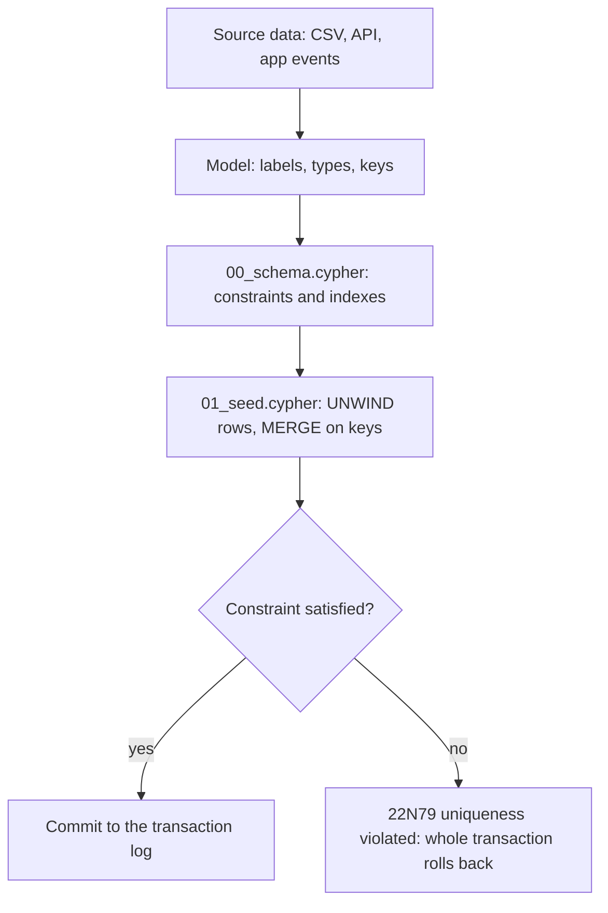

### 2.1 Property Types and the Type System

A property value must be one of a fixed set of storable types. Anything else can exist while a query runs but cannot be written to a node or relationship.

| Storable type | Literal or constructor | Notes |
| :--- | :--- | :--- |
| `BOOLEAN` | `true`, `false` | |
| `INTEGER` | `42` | 64-bit signed |
| `FLOAT` | `3.14` | 64-bit IEEE 754; do not store money as `FLOAT` (use integer cents) |
| `STRING` | `'text'` or `"text"` | Unicode; comparisons are case-sensitive |
| `DATE`, `LOCAL TIME`, `ZONED TIME`, `LOCAL DATETIME`, `ZONED DATETIME` | `date('2026-11-03')`, `datetime('2026-11-03T10:00:00[Europe/London]')` | Store instants as `ZONED DATETIME`; `date()` with no argument is today in the server time zone |
| `DURATION` | `duration('P1M2D')` | `date('2026-11-03') + duration('P1M')` is `2026-12-03` |
| `POINT` | `point({latitude: 51.5, longitude: -0.12})` | WGS-84 (SRID 4326) or Cartesian; enables `point.distance()` and point indexes |
| `LIST<T>` | `['a', 'b']` | Homogeneous lists of one of the types above |
| `VECTOR` | `vector([0.1, 0.2], 2, FLOAT32)` | Cypher 25; for embeddings |

What cannot be stored, and the error you get:

```cypher
CREATE (:Tmp {m: {a: 1}});
// 22N01: data exception - invalid type. Expected the value Map{a -> Long(1)} to be of type
// BOOLEAN, STRING, INTEGER, FLOAT, DATE, ... or POINT, but was of type MAP NOT NULL.

CREATE (:Tmp {xs: [1, 'a']});
// 22N39: data exception - unsupported property value type.
// Value String("a") cannot be stored in properties.
```

There is no stored `null`. Setting a property to `null` removes it, and reading a missing property returns `null`:

```cypher
MATCH (p:Person {handle: 'ada'})
SET p.nickname = 'countess'      // adds the key
SET p.nickname = null            // removes it again, same as REMOVE p.nickname
RETURN p.nickname IS NULL AS gone, keys(p) AS keys;
```

Cypher 5.9+ and Cypher 25 have type predicates and `valueType()`, which make type rules testable:

```cypher
MATCH (p:Person)
RETURN p.handle,
       p.joined IS :: DATE NOT NULL AS joinedIsDate,
       valueType(p.joined) AS t;
// "ada", TRUE, "DATE NOT NULL"
```

The starter's test `every Person.joined is a DATE, not a string` uses exactly this. Conversions are explicit and the `OrNull` variants never throw:

| Expression | Result |
| :--- | :--- |
| `toInteger('42')` | `42` |
| `toIntegerOrNull('x')` | `null` |
| `toFloat('1.5')` | `1.5` |
| `toString(2026)` | `'2026'` |
| `'1' + 1` | `'11'` (string concatenation, not addition) |
| `null = null` | `null`, not `true`; use `IS NULL` |

### 2.2 Node, Relationship or Property?

Most modelling mistakes come from putting a fact in the wrong kind of element. Ask what the queries need to do with it.

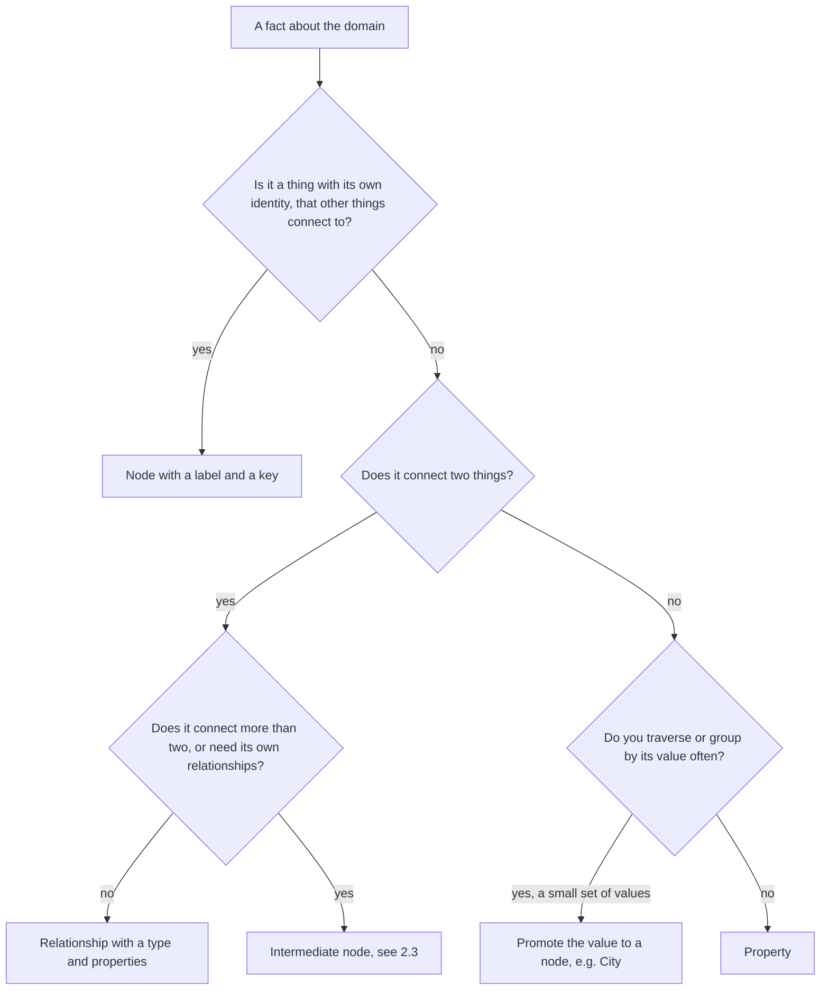

| Fact | Starter choice | Why |
| :--- | :--- | :--- |
| A developer | `(:Person {handle})` node | Has identity; many things connect to it |
| A skill | `(:Skill {name})` node, not a list property on `Person` | "Who else knows Go?" becomes a one-hop traversal instead of a scan of every person's list |
| How well someone knows a skill | `level` property on `KNOWS` | It describes the connection, not either end |
| When someone joined a project | `since` on `WORKS_ON`, with a relationship index | A fact about the pair; Stage 3 filters on it |
| A person's city | `city` property, with a range index | Only filtered on. Promote it to `(:City)` once you need city-level relationships (offices, regions) |
| Project dependency | `DEPENDS_ON` relationship | The whole point is traversing it transitively |

Labels are also cheap filters. A node can carry several (`:Person:Maintainer`), and `MATCH (m:Maintainer)` reads the label's token index instead of checking a property on every person. Use labels for a small number of stable categories; use properties for values with many distinct values.

### 2.3 Intermediate Nodes and Other Modelling Patterns

A relationship connects exactly two nodes. When a fact involves three or more things, or when you need to attach relationships to the fact itself, turn the relationship into a node.

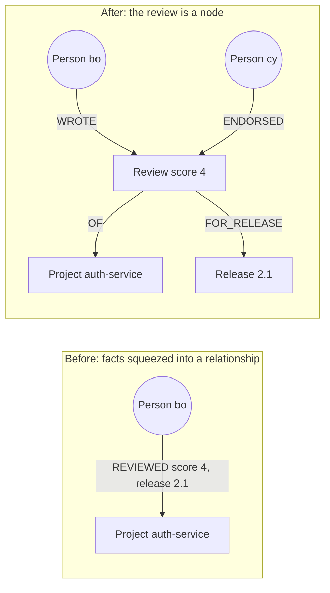

```cypher
MATCH (bo:Person {handle: 'bo'}), (p:Project {slug: 'auth-service'})
MERGE (r:Review {id: 'rev-auth-bo-2-1'})
  ON CREATE SET r.score = 4, r.at = datetime()
MERGE (bo)-[:WROTE]->(r)
MERGE (r)-[:OF]->(p)
MERGE (v:Release {project: 'auth-service', version: '2.1'})
MERGE (r)-[:FOR_RELEASE]->(v);
```

Other patterns that come up early:

| Pattern | Use it for | Shape |
| :--- | :--- | :--- |
| Intermediate node (hyperedge) | Facts with more than two participants, or that others refer to | `(:Person)-[:WROTE]->(:Review)-[:OF]->(:Project)` |
| Linked list | Ordered events, versions | `(:Release)-[:NEXT]->(:Release)`, plus `(:Project)-[:LATEST]->(:Release)` for O(1) access |
| Fan-out per period | Supernodes on a time axis | `(:Project)-[:STARS_IN]->(:Month {ym: '2026-10'})` instead of millions of rels on one node |
| Multiple labels as state | Lifecycle flags you filter on | `SET p:Archived` / `REMOVE p:Archived` |
| Relationship type per meaning | Separate traversals | `FOLLOWS` and `BLOCKS`, not `RELATES {kind: 'follows'}`: types are filtered at the relationship-group level, properties are not |

### 2.4 The Starter Model

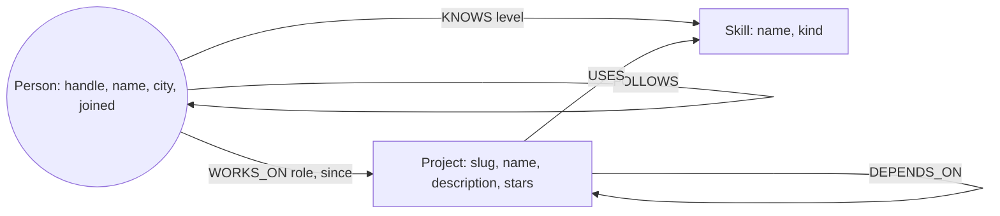

The schema file declares what the database must enforce, before any data arrives:

```cypher
CREATE CONSTRAINT person_handle IF NOT EXISTS
FOR (p:Person) REQUIRE p.handle IS UNIQUE;

CREATE CONSTRAINT skill_name IF NOT EXISTS
FOR (s:Skill) REQUIRE s.name IS UNIQUE;

CREATE CONSTRAINT project_slug IF NOT EXISTS
FOR (p:Project) REQUIRE p.slug IS UNIQUE;

CREATE INDEX person_city IF NOT EXISTS FOR (p:Person) ON (p.city);
CREATE INDEX works_on_since IF NOT EXISTS FOR ()-[w:WORKS_ON]-() ON (w.since);
CREATE TEXT INDEX project_name_text IF NOT EXISTS FOR (p:Project) ON (p.name);
CREATE FULLTEXT INDEX project_search IF NOT EXISTS
FOR (p:Project) ON EACH [p.name, p.description];

CALL db.awaitIndexes(120);
```

| Line | Role | What happens at runtime |
| :--- | :--- | :--- |
| `CREATE CONSTRAINT ... IS UNIQUE` | Business key | Creates a RANGE index owned by the constraint; any write that would duplicate the value fails and rolls back the whole transaction |
| `IF NOT EXISTS` | Idempotency | Re-running the file is a no-op instead of an error |
| `CREATE INDEX ... ON (p.city)` | Range index for equality and range predicates | Used by `WHERE p.city = $c` and `STARTS WITH` |
| `FOR ()-[w:WORKS_ON]-()` | Relationship property index | Lets the planner start from relationships instead of scanning nodes |
| `TEXT INDEX` | Trigram-style index for strings | Speeds up `CONTAINS` and `ENDS WITH` |
| `FULLTEXT INDEX` | Lucene analyser, scored | Queried with `db.index.fulltext.queryNodes`, not with `WHERE` |
| `db.awaitIndexes(120)` | Wait for population | Indexes build in the background; without this, the seed could run before they are `ONLINE` |

### 2.5 Writing: CREATE, SET, REMOVE and DELETE

```cypher
// CREATE always creates
CREATE (p:Person {handle: 'zoe', name: 'Zoe Ito'});

// SET one property, several at once, or merge a map in
MATCH (p:Person {handle: 'zoe'})
SET p.city = 'Kyoto',
    p += {joined: date('2026-11-01'), timezone: 'Asia/Tokyo'};

// SET p = map REPLACES all properties: dangerous on a node with a key
MATCH (p:Person {handle: 'zoe'})
SET p = {handle: 'zoe', name: 'Zoe Ito'};   // city, joined and timezone are gone

// Labels
MATCH (p:Person {handle: 'zoe'})
SET p:Maintainer
REMOVE p:Maintainer;

// Remove a property
MATCH (p:Person {handle: 'zoe'})
REMOVE p.timezone;

// Delete
MATCH (p:Person {handle: 'zoe'})
DETACH DELETE p;
```

| Operation | Effect | Gotcha |
| :--- | :--- | :--- |
| `SET n.k = v` | Sets one property | `v = null` removes the key |
| `SET n += map` | Adds or overwrites the map's keys | Keys mapped to `null` are removed |
| `SET n = map` | Replaces every property | Drops keys not in the map, including ones you forgot about |
| `SET n:Label` / `REMOVE n:Label` | Adds or removes a label | `SET n:$($label)` takes a dynamic label from a parameter |
| `DELETE r` | Deletes a relationship | Fine on its own |
| `DELETE n` | Deletes a node with no relationships | `G1001 ... edges still exist` otherwise |
| `DETACH DELETE n` | Deletes a node and all its relationships | On a supernode this is one huge transaction; batch it (2.8) |

Relationship types cannot be renamed in place. To change `WORKS_ON` to `CONTRIBUTES_TO`, create the new relationship, copy properties and delete the old one:

```cypher
MATCH (p:Person)-[old:WORKS_ON]->(pr:Project)
CALL (p, old, pr) {
  CREATE (p)-[new:CONTRIBUTES_TO]->(pr)
  SET new = properties(old)
  DELETE old
} IN TRANSACTIONS OF 1000 ROWS;
```

### 2.6 MERGE in Depth

`MERGE` is "match the whole pattern; if there is no match, create the whole pattern". It is the tool for idempotent loads, and the source of most duplicate-data bugs.

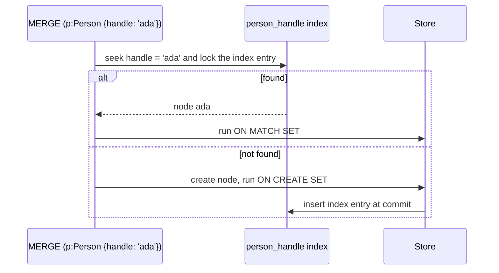

```cypher
MERGE (p:Person {handle: 'ada'})
  ON CREATE SET p.created = datetime(), p.seen = 0
  ON MATCH SET p.seen = coalesce(p.seen, 0) + 1
RETURN p.handle, p.seen;
```

Rules that keep `MERGE` correct:

1. **Merge on the key only, set everything else.** `MERGE (p:Person {handle: $h, name: $name})` creates a second `ada` when the name changes. Write `MERGE (p:Person {handle: $h}) SET p.name = $name`.
2. **Merge nodes first, relationships second.** `MERGE` on a whole pattern creates every element that does not match as a unit:

   ```cypher
   // zed does not exist, so MERGE tries to create the WHOLE pattern, including a new ada
   MERGE (a:Person {handle: 'ada'})-[:FOLLOWS]->(b:Person {handle: 'zed'});
   // With the constraint: 22N80 ... Node(20) already exists with label `Person`
   //   and property `handle` = 'ada'
   // Without it: a silent second ada.

   // Correct
   MERGE (a:Person {handle: 'ada'})
   MERGE (b:Person {handle: 'zed'})
   MERGE (a)-[:FOLLOWS]->(b);
   ```

   The seed goes one step further: it `MATCH`es both ends and `MERGE`s only the relationship, so a typo in a handle produces zero rows instead of an invented person.
3. **Never merge on `null`.** `MERGE (p:Person {handle: null})` fails with `22N31 ... 'MERGE' cannot be used with a graph element property value that is null`. Filter missing keys out of the input first.
4. **Back every merge key with a uniqueness constraint.** Under concurrency two transactions can both find "no match" and both create. The constraint's index entry lock serialises them so the second one matches instead (Stage 4 covers the locking).
5. **Relationship `MERGE` without direction** (`MERGE (a)-[:FOLLOWS]-(b)`) matches either direction and, if neither exists, creates one in a direction you did not choose. Always give a direction when writing.

### 2.7 Constraints and Editions

| Constraint | Syntax | Edition | Enforces |
| :--- | :--- | :--- | :--- |
| Node property uniqueness | `REQUIRE p.handle IS UNIQUE` | Community and Enterprise | No two nodes with the label share the value. Nodes without the property are allowed |
| Relationship property uniqueness | `FOR ()-[r:PAID]-() REQUIRE r.txId IS UNIQUE` | Community and Enterprise | Same, for relationships |
| Composite uniqueness | `REQUIRE (r.project, r.version) IS UNIQUE` | Community and Enterprise | The combination is unique |
| Property existence | `REQUIRE p.handle IS NOT NULL` | Enterprise | The property is present on every node with the label |
| Property type | `REQUIRE p.joined IS :: DATE` | Enterprise | Values have the declared type |
| Node or relationship key | `REQUIRE (p.handle) IS NODE KEY` | Enterprise | Exists **and** unique |

On Community Edition the Enterprise-only kinds fail at creation time:

```text
51N27: system configuration or operation exception - not supported in this edition.
Property existence constraint is not supported in community edition.
```

On Community, cover the gap with tests: the starter checks `IS :: DATE NOT NULL` and level ranges in [`tests/02_data_test.cypher`](tests/02_data_test.cypher) instead of relying on type constraints.

Managing constraints:

```cypher
SHOW CONSTRAINTS YIELD name, type, labelsOrTypes, properties, ownedIndex;
DROP CONSTRAINT person_handle IF EXISTS;
```

Creating a constraint on existing data scans the data and fails if it already holds duplicates. Find them first:

```cypher
MATCH (p:Person)
WITH p.handle AS handle, collect(p) AS nodes
WHERE size(nodes) > 1
RETURN handle, size(nodes) AS copies;
```

Uniqueness is exact and case-sensitive: `'ADA'` and `'ada'` are different values, which the starter's last data test proves. Normalise keys before writing them, for example `toLower(trim($handle))`.

### 2.8 Batch Loading: UNWIND, LOAD CSV and CALL IN TRANSACTIONS

Send rows as one parameter and let `UNWIND` turn them into rows. One round trip, one plan, many writes:

```cypher
:param rows => [{handle: 'ivy', name: 'Ivy Chen', city: 'Taipei'}, {handle: 'jo', name: 'Jo Adeyemi', city: 'Lagos'}]

UNWIND $rows AS row
MERGE (p:Person {handle: row.handle})
SET p.name = row.name, p.city = row.city;
```

For files, `LOAD CSV` streams rows from the server's `import` directory or a URL:

```cypher
// people.csv in /var/lib/neo4j/import (mount a host folder at /import in Docker)
LOAD CSV WITH HEADERS FROM 'file:///people.csv' AS row
CALL (row) {
  MERGE (p:Person {handle: toLower(trim(row.handle))})
  SET p.name = row.name,
      p.city = row.city,
      p.joined = date(row.joined)
} IN TRANSACTIONS OF 1000 ROWS
  ON ERROR CONTINUE
  REPORT STATUS AS s
WITH s WHERE s.errorMessage IS NOT NULL
RETURN s.transactionId, s.errorMessage;
```

| Part | Role | What happens at runtime |
| :--- | :--- | :--- |
| `LOAD CSV WITH HEADERS` | Each row becomes a map keyed by the header | All values are strings: convert with `date()`, `toInteger()` and friends |
| `CALL (row) { ... }` | Subquery with an explicit import list | The inner block runs once per row |
| `IN TRANSACTIONS OF 1000 ROWS` | Commits every 1000 rows | Keeps heap use flat. Needs an auto-commit (implicit) transaction: `cypher-shell` and `executeQuery` style calls are, `:begin` blocks are not |
| `ON ERROR CONTINUE` | A failing batch rolls back alone | The others still commit. Alternatives: `BREAK`, `FAIL` (default), `RETRY FOR 3 SECONDS THEN FAIL` |
| `REPORT STATUS AS s` | One status map per inner transaction | `{started, committed, transactionId, errorMessage}` |

The starter's constraint tests use the same mechanism to assert that a write fails without aborting the test file:

```cypher
CALL () {
  CREATE (:Person {handle: 'ada', name: 'Second Ada'})
} IN TRANSACTIONS ON ERROR CONTINUE REPORT STATUS AS s
RETURN 'duplicate Person.handle is rejected' AS test,
       s.committed = false AND s.errorMessage CONTAINS 'already exists' AS ok;
```

For lock-free inserts at volume, `IN 4 CONCURRENT TRANSACTIONS OF 1000 ROWS` runs batches in parallel. Use it for creates on disjoint data; for `MERGE`s that touch shared nodes it causes lock contention and deadlock retries. For an initial load of millions of rows into an empty database, the offline `neo4j-admin database import` tool (Stage 5) is an order of magnitude faster than any Cypher.

### 2.9 Parameters, Plan Caching and Injection

Always pass values as parameters:

```cypher
// Good: one cached plan for every handle
MATCH (p:Person {handle: $handle}) RETURN p.name;

// Bad: a new query string, so a new plan, per handle, and an injection risk
// "MATCH (p:Person {handle: '" + userInput + "'}) RETURN p.name"
```

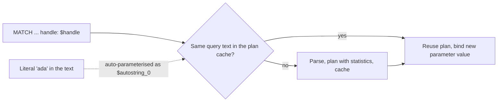

The planner auto-parameterises simple literals (the plan in section 3.9 shows `$autostring_0`), but string concatenation of user input is still an injection hole: a value like `ada'}) DETACH DELETE p //` changes the query. Labels, relationship types and property keys cannot be ordinary parameters; use Cypher's dynamic forms with a parameter, or validate them against an allow-list:

```cypher
// Dynamic label from a parameter, safe because it is a value, not query text
MATCH (n:$($label) {handle: $handle})
RETURN n;
```

Parameter types map from the driver's native types: a Java `LocalDate` becomes `DATE`, a Python `datetime` with `tzinfo` becomes `ZONED DATETIME`, a JavaScript `number` becomes `FLOAT` unless you wrap it with `neo4j.int()`.

### 2.10 Refactoring a Live Graph

Graph schemas change. Write migrations as idempotent Cypher files, run them in batches, and verify with a query that returns zero when done.

```cypher
// 1. Promote Person.city to City nodes
MATCH (p:Person) WHERE p.city IS NOT NULL
CALL (p) {
  MERGE (c:City {name: p.city})
  MERGE (p)-[:LIVES_IN]->(c)
} IN TRANSACTIONS OF 1000 ROWS;

// 2. Verify, then drop the old property in a separate migration
MATCH (p:Person) WHERE p.city IS NOT NULL AND NOT (p)-[:LIVES_IN]->(:City)
RETURN count(p) AS remaining;        // must be 0

// 3. Rename a label in batches
MATCH (n:Skill)
CALL (n) { SET n:Technology REMOVE n:Skill } IN TRANSACTIONS OF 1000 ROWS;
```

| Change | Safe sequence |
| :--- | :--- |
| Add a property | Deploy readers that tolerate `null`, backfill in batches, then add the constraint (Enterprise: existence) |
| Rename a property | Write both keys, backfill, switch readers, stop writing the old key, remove it in batches |
| Rename a label | Add the new label to all nodes, switch queries, remove the old label. Recreate constraints and indexes on the new label first |
| Split a node type | Add the new label to the subset, move relationships, then remove properties that no longer belong |
| Change a relationship type | Create the new type alongside, switch readers, delete the old type (2.5) |

Keep migrations in numbered files next to the schema, the same way the starter numbers `00_schema.cypher` and `01_seed.cypher`, and record applied migrations in the graph itself, for example `MERGE (m:Migration {id: '0003-city-nodes'}) ON CREATE SET m.applied = datetime()`. Stage 5 covers migration tooling.

### 2.11 Pitfalls

| Pitfall | Symptom | Fix |
| :--- | :--- | :--- |
| `MERGE` with non-key properties | Duplicate nodes whenever a non-key value changes | `MERGE` on the key, `SET` the rest |
| `MERGE` on a full pattern | `22N80 ... already exists with label Person` or, without a constraint, silent duplicates | Merge each node, then the relationship |
| `MERGE` with a `null` key | `22N31 ... 'MERGE' cannot be used with a graph element property value that is null` | `WHERE row.handle IS NOT NULL` before `MERGE` |
| `MERGE` without a constraint under load | Occasional duplicates that never reproduce in tests | Uniqueness constraint on every merge key |
| `SET n = $map` | Properties vanish after an "update" | `SET n += $map` |
| Storing a map | `22N01 ... but was of type MAP NOT NULL` | Flatten to properties, store JSON as a string, or model it as a node |
| Mixed-type lists | `22N39 ... cannot be stored in properties` | Convert all elements to one type |
| Creating a constraint on dirty data | Constraint creation fails, naming a conflicting node | Find duplicates with `collect` + `size > 1`, merge them, then create the constraint |
| `CALL { } IN TRANSACTIONS` in an explicit transaction | `A query with 'CALL { ... } IN TRANSACTIONS' can only be executed in an implicit transaction, but tried to execute in an explicit transaction.` | Run it in auto-commit mode; in Browser prefix with `:auto` |
| `LOAD CSV` values treated as numbers | `row.stars > 100` compares strings | Convert: `toInteger(row.stars)` |
| Expecting Enterprise constraints on Community | `51N27 ... not supported in community edition` | Uniqueness constraints plus data tests, or Enterprise |

### 2.12 Best Practices

- **Write the schema file first and make it idempotent** (`IF NOT EXISTS`): every environment converges to the same constraints.
- **One business key per label, backed by a uniqueness constraint**: it is the only reliable way to make `MERGE` safe under concurrency.
- **Normalise keys before writing** (`toLower(trim())`): uniqueness is exact and case-sensitive.
- **Load with `UNWIND $rows` in batches of 1,000-10,000**: one round trip per batch and a cached plan.
- **`MATCH` the ends, `MERGE` the relationship** when loading edges between existing nodes: bad references produce no rows instead of phantom nodes.
- **Choose relationship types for the traversals you run**: types are filtered in the store, properties are not.
- **Store temporal values as temporal types**: string dates compare lexically and silently break ranges.
- **Keep migrations reversible in two steps** (expand, then contract): readers and writers never see a half-migrated model.

### 2.13 Hands-on Exercise

Extend the model with reviews (the intermediate-node pattern from 2.3):

1. Add a uniqueness constraint `review_id` on `Review.id`.
2. Load these reviews with one `UNWIND` statement that `MATCH`es people and projects and `MERGE`s the review: bo reviews `auth-service` with score 4, cy reviews `graph-gateway` with score 5, ada reviews `ingest-pipeline` with score 3. Use ids `r1`, `r2`, `r3`.
3. Run the load twice and show that the counts do not change.
4. Prove the constraint works with a `CALL { } IN TRANSACTIONS ... REPORT STATUS` query that tries to create a second `r1`.
5. Remove everything you added so the starter tests pass again.

Expected output: after step 2 and again after step 3, `MATCH (r:Review) RETURN count(r)` returns `3` and `MATCH ()-[x:WROTE|OF]->() RETURN count(x)` returns `6`. Step 4 returns `committed: FALSE` with an error message containing `already exists`. After step 5, `bash scripts/run-tests.sh` with `RESET=1` reports `39 passed, 0 failed`.

Solution: [`exercises/stage2.cypher`](exercises/stage2.cypher).

[Back to top ⤴️](#-table-of-contents)

---

## 3. Stage 3: Pattern Matching, Aggregation, Paths & Indexes

This stage is reading the graph well: how pattern matching decides what counts as a match, how aggregation groups rows, how subqueries and quantified path patterns express questions that need several hops, and how indexes and the planner decide what the database actually does. Prerequisite: Stages 1 and 2, with the starter loaded. Afterwards you can read every query in [`tests/03_queries_test.cypher`](tests/03_queries_test.cypher), write recommendation and dependency queries of your own and explain their plans.

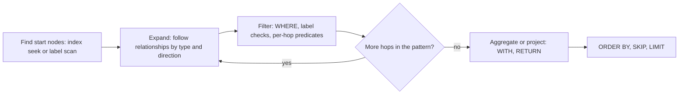

### 3.1 Pattern Matching Semantics

A `MATCH` returns every way the pattern can be mapped onto the graph. Two rules define "every way":

- **Relationship isomorphism (trail semantics)**: within one `MATCH`, a relationship is used at most once. Nodes may repeat.
- **Direction and type are part of the pattern**: `(a)-[:FOLLOWS]->(b)` and `(a)<-[:FOLLOWS]-(b)` are different patterns; `(a)-[:FOLLOWS]-(b)` matches both directions and returns each undirected match twice when both endpoints are unbound.

The cycle test in the starter makes the first rule visible:

```cypher
MATCH p = (a:Person {handle: 'ada'})-[:FOLLOWS]->+(a)
RETURN length(p) AS hops, [n IN nodes(p) | n.handle] AS route
ORDER BY hops;
```

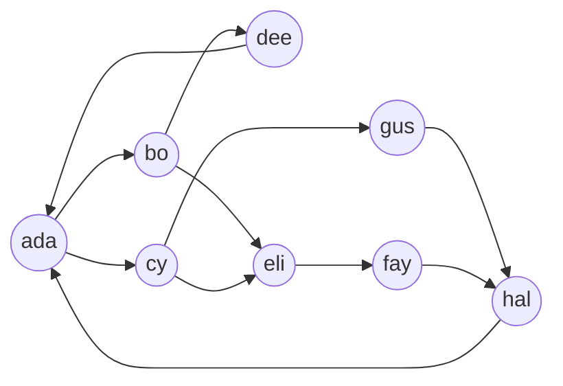

There are four simple cycles through ada (3, 4, 5 and 5 hops). The query returns **8** paths, because a trail may pass through ada again and continue: ada → bo → dee → ada → cy → gus → hal → ada uses seven different relationships, so it is a legal match. If you want simple cycles only, filter repeated nodes:

```cypher
MATCH p = (a:Person {handle: 'ada'})-[:FOLLOWS]->+(a)
WHERE size(coll.distinct(nodes(p))) = length(p)
RETURN count(p) AS simpleCycles;        // 4
```

Cypher 25 adds a match mode that relaxes the rule instead: `MATCH REPEATABLE ELEMENTS p = (a)-[:R]->{1,3}(b)` allows a relationship to repeat. Only bounded quantifiers are allowed with it, because unbounded repetition would never end.

Separate `MATCH` clauses do not share the uniqueness rule. That is the difference between these two:

```cypher
// One MATCH: friend and fof are reached by different FOLLOWS relationships
MATCH (me:Person {handle: 'ada'})-[:FOLLOWS]->(friend)-[:FOLLOWS]->(fof)
RETURN count(*);

// Two MATCHes: the second may reuse a relationship the first one used
MATCH (me:Person {handle: 'ada'})-[:FOLLOWS]->(friend)
MATCH (friend)-[:FOLLOWS]->(fof)
RETURN count(*);
```

### 3.2 OPTIONAL MATCH and null

`OPTIONAL MATCH` is the graph equivalent of a left outer join: if the pattern has no match, the row survives and the new variables are `null`.

```cypher
MATCH (pr:Project)
OPTIONAL MATCH (pr)-[:USES]->(s:Skill {kind: 'language'})
RETURN pr.slug, collect(s.name) AS languages
ORDER BY pr.slug;
```

```text
pr.slug, languages
"auth-service", ["Go"]
"core-lib", ["Java"]
"graph-gateway", ["Go"]
"ingest-pipeline", ["Python"]
"metrics-agent", ["Rust"]
"ui-kit", []
```

`collect()` and `count(x)` skip `null`, which is why `ui-kit` shows an empty list and the starter's test `skills per project, including zero` sees `ui-kit:0`. `count(*)` counts rows, so it would report `1` for `ui-kit`.

Two traps:

- **A `WHERE` belongs to the clause directly before it.** `OPTIONAL MATCH (pr)-[:USES]->(s) WHERE s.kind = 'language'` filters inside the optional match and keeps `ui-kit`. A `WHERE` after a following `WITH` would drop it.
- **`null` propagates.** `null = null` is `null`, `null + 1` is `null`, and a `WHERE` that evaluates to `null` removes the row. Test with `IS NULL` / `IS NOT NULL`, and use `coalesce(x, default)` to pick a value.

### 3.3 Aggregation and Grouping Keys

Cypher has no `GROUP BY`. In a `WITH` or `RETURN` that contains an aggregate, every non-aggregated expression is a grouping key.

```cypher
MATCH (p:Person)-[k:KNOWS]->(s:Skill)
RETURN s.name AS skill,                       // grouping key
       count(*) AS people,                    // aggregates
       max(k.level) AS best,
       percentileCont(k.level, 0.5) AS median,
       collect(p.handle) AS who
ORDER BY skill;
```

```text
skill, people, best, median, who
"Cypher", 3, 5, 4, ["cy", "hal", "ada"]
"Go", 3, 5, 4, ["bo", "eli", "gus"]
"Java", 2, 4, 3.5, ["dee", "ada"]
"Kubernetes", 2, 5, 4.5, ["bo", "gus"]
"Python", 3, 4, 3, ["cy", "fay", "hal"]
"Rust", 2, 5, 3.5, ["dee", "eli"]
```

| Function | Returns | Note |
| :--- | :--- | :--- |
| `count(*)` | Number of rows | Includes rows where variables are `null` |
| `count(x)`, `count(DISTINCT x)` | Non-null values, optionally distinct | `count(DISTINCT friend)` is how the recommendation query counts mutual friends |
| `sum`, `avg`, `min`, `max` | Numeric or comparable aggregates | `avg` of integers returns a float: the starter tests `avg(k.level) = 4.0` |
| `collect(x)`, `collect(DISTINCT x)` | A list | Order follows row order; sort before collecting if you need an order |
| `percentileCont`, `percentileDisc`, `stDev` | Statistics | Interpolated vs nearest value |

Mixing an aggregate with a non-grouping variable in one expression is an error:

```cypher
MATCH (p:Person) RETURN p.city, p.handle + count(*);
// 42I18: ... The expression contains a non-grouping sub-expression `p`.
// In an aggregating context only grouping sub-expressions and constants are allowed.
```

Split it with `WITH`: aggregate first, then compute. The starter does this everywhere it builds a test result:

```cypher
MATCH (p:Person)
WITH CASE WHEN p.joined < date('2022-01-01') THEN 'early' ELSE 'recent' END AS cohort,
     count(*) AS c
ORDER BY cohort
WITH collect(cohort + ':' + c) AS got
RETURN got;                                  // ["early:3", "recent:5"]
```

To sort what `collect` produces, put `ORDER BY` in the `WITH` before it, as above, or use `coll.sort()` on the result in Cypher 25.

### 3.4 WITH, UNWIND, Lists and CASE

`WITH` chains query parts; `UNWIND` turns a list into rows; list and pattern comprehensions build lists without changing the row count.

```cypher
MATCH (p:Person)
RETURN p.handle,
       [(p)-[:WORKS_ON]->(pr) | pr.slug] AS projects,             // pattern comprehension
       [s IN ['Go', 'Rust'] WHERE (p)-[:KNOWS]->(:Skill {name: s})] AS systemsSkills,
       CASE WHEN COUNT { (p)<-[:FOLLOWS]-() } >= 2 THEN 'popular' ELSE 'quiet' END AS reach
ORDER BY p.handle;
```

```text
p.handle, projects, systemsSkills, reach
"ada", ["core-lib", "graph-gateway"], [], "popular"
"bo", ["graph-gateway", "auth-service"], ["Go"], "quiet"
...
```

| Construct | Row count effect | Typical use |
| :--- | :--- | :--- |
| `WITH a, count(*) AS n` | Groups | Aggregate mid-query, filter on the aggregate with a following `WHERE` |
| `WITH DISTINCT x` | De-duplicates | Remove duplicate paths before a second expansion |
| `WITH ... ORDER BY ... LIMIT 10` | Truncates | Top-N before an expensive step |
| `UNWIND list AS x` | One row per element; an empty list removes the row | Batch input, list to rows |
| `[x IN list WHERE pred \| expr]` | None | Filter and map a list |
| `[(a)-->(b) \| b.name]` | None | Collect neighbours per row |
| `reduce(acc = 0, x IN list \| acc + x)` | None | Fold a list |
| `CASE WHEN ... THEN ... ELSE ... END` | None | Bucketing, conditional values |

`UNWIND []` drops the row; when a list may be empty and you want to keep the row, use `UNWIND CASE WHEN size(xs) = 0 THEN [null] ELSE xs END AS x`, or move the work into a `CALL` subquery.

### 3.5 Subqueries: EXISTS, COUNT, COLLECT and CALL

Subquery expressions run a pattern or a whole query per outer row and return a single value:

```cypher
// EXISTS: a predicate
MATCH (p:Person)
WHERE EXISTS { (p)-[:WORKS_ON]->(:Project)-[:USES]->(:Skill {name: 'Cypher'}) }
RETURN collect(p.handle) AS cypherProjectsPeople;        // ada, bo, cy, fay, hal

// COUNT: a number
MATCH (p:Person)
WHERE COUNT { (p)-[:WORKS_ON]->(:Project) } >= 2
RETURN collect(p.handle) AS multiProject;                  // ada, bo, hal

// COLLECT: a list, from a full subquery with its own ORDER BY
MATCH (pr:Project {slug: 'graph-gateway'})
RETURN COLLECT {
  MATCH (p:Person)-[w:WORKS_ON]->(pr)
  RETURN p.handle ORDER BY w.since
} AS team;                                                 // ["ada", "bo", "hal"]
```

`CALL () { ... }` runs a subquery that can return several columns and rows, write data, or combine branches with `UNION`. The parentheses list the outer variables it may see; `()` means none.

```cypher
// Top two people per skill by level, as one query
MATCH (s:Skill)
CALL (s) {
  MATCH (p:Person)-[k:KNOWS]->(s)
  RETURN p.handle AS who, k.level AS level
  ORDER BY level DESC, who
  LIMIT 2
}
RETURN s.name AS skill, collect(who + ' ' + level) AS top2
ORDER BY skill;
```

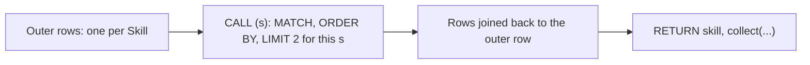

| Form | Returns | Can write | Use it for |
| :--- | :--- | :--- | :--- |
| `EXISTS { pattern or query }` | Boolean | No | Filters; replaces `exists((a)-->())` |
| `COUNT { ... }` | Integer | No | Degree checks; replaces `size((a)-->())` |
| `COLLECT { ... RETURN one column }` | List | No | Ordered lists per row |
| `CALL (vars) { ... }` | Rows and columns | Yes | Per-row top-N, `UNION` post-processing, batched writes |

A `CALL` subquery that returns nothing (a write-only block) keeps the outer row count unchanged. A subquery that returns zero rows for an outer row removes that row, the same as a failing `MATCH`; `OPTIONAL CALL (s) { ... }` keeps it with `null`s.

### 3.6 Variable-Length Paths and Quantified Path Patterns

Quantifiers repeat part of a pattern. They replace the older `*min..max` syntax and are more expressive, because a quantified group can contain nodes with labels and per-hop `WHERE` clauses.

| Syntax | Meaning |
| :--- | :--- |
| `-[:DEPENDS_ON]->+` | One or more hops (shorthand for `{1,}`) |
| `-[:DEPENDS_ON]->*` | Zero or more hops |
| `-[:DEPENDS_ON]->{2}` | Exactly two |
| `-[:DEPENDS_ON]->{1,3}` | One to three |
| `((a)-[:R]->(b) WHERE b.stars < a.stars){2}` | A group repeated twice, filtered at each hop |
| `-[:DEPENDS_ON*1..]->` | Legacy variable-length relationship; still accepted |

```cypher
// Everything graph-gateway depends on, at any depth
MATCH (:Project {slug: 'graph-gateway'})-[:DEPENDS_ON]->+(dep:Project)
RETURN collect(DISTINCT dep.slug) AS closure;    // auth-service, ui-kit, core-lib

// How many distinct paths reach core-lib? Two: via auth-service and via ui-kit
MATCH p = (:Project {slug: 'graph-gateway'})-[:DEPENDS_ON]->+(:Project {slug: 'core-lib'})
RETURN count(p) AS paths;                         // 2

// Per-hop filter: walk only to dependencies with fewer stars than the current project
MATCH (:Project {slug: 'graph-gateway'})
      ((a:Project)-[:DEPENDS_ON]->(b:Project) WHERE b.stars < a.stars){2}
      (leaf)
RETURN collect(DISTINCT leaf.slug) AS leaves;     // ["core-lib"], via auth-service only
```

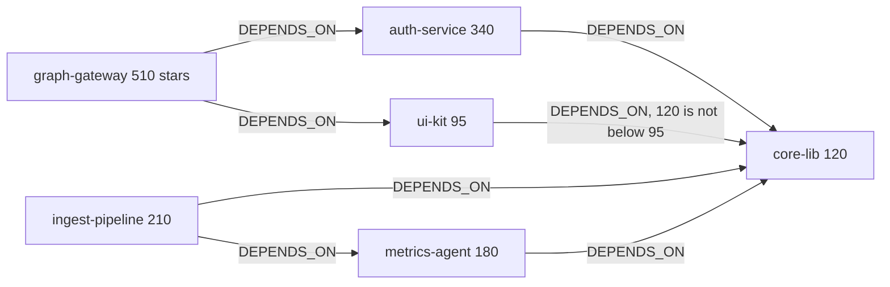

Variables inside a quantified group become lists: in the last query `a` and `b` are lists of the nodes at each repetition, so after the pattern you would write `[x IN a | x.slug]`.

The number of paths grows quickly with depth. Paths multiply, distinct endpoints do not; whenever you want "which nodes", not "which routes", reduce with `DISTINCT` as early as you can. The starter's star-sum test shows why: summing over paths would count `core-lib` twice; `WITH DISTINCT d` before `sum(d.stars)` gives 555.

### 3.7 Shortest Paths

`SHORTEST` is a path selector: it keeps only the shortest matches between each pair of endpoints.

```cypher
// One shortest route
MATCH p = SHORTEST 1 (:Person {handle: 'ada'})-[:FOLLOWS]->+(:Person {handle: 'hal'})
RETURN [n IN nodes(p) | n.handle] AS route;       // ["ada", "cy", "gus", "hal"]

// All routes of the shortest length
MATCH p = ALL SHORTEST (:Person {handle: 'bo'})-[:FOLLOWS]->+(:Person {handle: 'hal'})
RETURN [n IN nodes(p) | n.handle] AS route;       // ["bo", "eli", "fay", "hal"]

// The two shortest lengths, with every path of those lengths
MATCH p = SHORTEST 2 GROUPS (:Person {handle: 'ada'})-[:FOLLOWS]->+(:Person {handle: 'hal'})
RETURN length(p) AS hops, [n IN nodes(p) | n.handle] AS route
ORDER BY hops;
```

```text
hops, route
3, ["ada", "cy", "gus", "hal"]
4, ["ada", "bo", "eli", "fay", "hal"]
4, ["ada", "cy", "eli", "fay", "hal"]
```

| Selector | Keeps |
| :--- | :--- |
| `SHORTEST 1` / `ANY SHORTEST` | One shortest path per endpoint pair |
| `SHORTEST k` | Up to k paths in order of length |
| `ALL SHORTEST` | Every path with the minimum length |
| `SHORTEST k GROUPS` | Every path whose length is among the k smallest |
| `ANY k` | Any k paths, no length guarantee; cheap existence checks |
| `shortestPath()`, `allShortestPaths()` | Legacy functions with `*` patterns; same results for simple cases |

Shortest paths are unweighted: they minimise the number of hops. For weighted routes (distance, cost, latency) use the Graph Data Science library's Dijkstra, A* or Yen's algorithms, covered in a masterclass later in this guide. Always bind both endpoints with an index lookup first; a shortest-path search from an unbound side explores the whole reachable graph.

### 3.8 Recommendation and Relational-Division Queries

Two query shapes cover a large share of real graph workloads.

**Collaborative filtering (friend of friend, people who bought...).** Expand two hops, exclude what the start node already has, rank by the number of distinct supporting paths:

```cypher
MATCH (me:Person {handle: $me})-[:FOLLOWS]->(friend:Person)-[:FOLLOWS]->(fof:Person)
WHERE fof <> me AND NOT (me)-[:FOLLOWS]->(fof)
RETURN fof.handle AS suggestion, count(DISTINCT friend) AS mutual,
       collect(DISTINCT friend.handle) AS via
ORDER BY mutual DESC, suggestion
LIMIT 10;
```

```text
suggestion, mutual, via
"eli", 2, ["cy", "bo"]
"dee", 1, ["bo"]
"gus", 1, ["cy"]
```

The planner recognises the "friends of friends I am not connected to" shape and uses a `TriadicSelection` operator for the `NOT (me)-[:FOLLOWS]->(fof)` check (section 3.9).

**Relational division (who has all of...).** Collect the requirements, then test every one:

```cypher
// People who know every skill auth-service uses
MATCH (pr:Project {slug: 'auth-service'})
WITH COLLECT { MATCH (pr)-[:USES]->(s:Skill) RETURN s } AS needed
MATCH (p:Person)
WHERE all(s IN needed WHERE (p)-[:KNOWS]->(s))
RETURN collect(p.handle) AS canStaff;              // ["bo", "gus"]
```

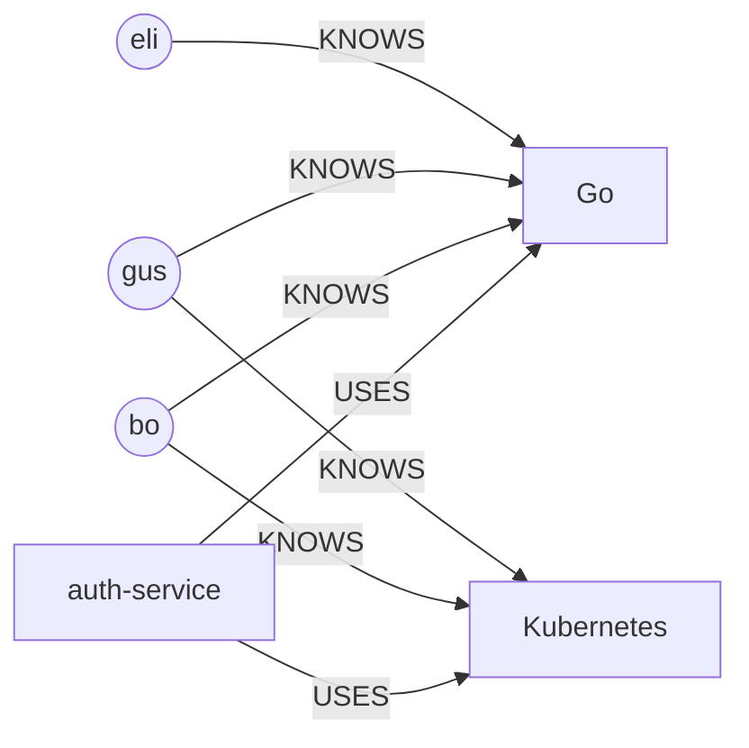

`eli` knows Go but not Kubernetes, so `all()` rejects him. A variant ranks partial matches instead: `count { (p)-[:KNOWS]->(s) WHERE s IN needed }` per person, ordered descending.

Both shapes, and the "who could join ingest-pipeline" variant, are checked by exact-answer tests in [`tests/03_queries_test.cypher`](tests/03_queries_test.cypher).

### 3.9 Indexes: Kinds and How to Choose

Indexes in Neo4j find **starting points**. Once the query has a node, it traverses without indexes.

| Index | Create | Serves | Does not serve |
| :--- | :--- | :--- | :--- |
| Token lookup (2 per database, automatic) | Present by default | `MATCH (n:Label)`, `MATCH ()-[r:TYPE]->()` | Property filters |
| RANGE | `CREATE INDEX FOR (n:L) ON (n.p)` | `=`, `<`, `>`, `IN`, `STARTS WITH`, `IS NOT NULL`, ordering | `CONTAINS`, `ENDS WITH` efficiently |
| Composite RANGE | `ON (n.a, n.b)` | Equality on leading properties plus a range on the next | Queries that skip the first property |
| TEXT | `CREATE TEXT INDEX ... ON (n.p)` | `CONTAINS`, `ENDS WITH`, `=` on strings | Non-string values |
| POINT | `CREATE POINT INDEX ... ON (n.location)` | `point.distance(...) < r`, `point.withinBBox` | Other types |
| FULLTEXT | `CREATE FULLTEXT INDEX ... ON EACH [n.a, n.b]` | Tokenised, scored search via `db.index.fulltext.queryNodes` | `WHERE` predicates |
| VECTOR | `CREATE VECTOR INDEX ... ON n.embedding` | Approximate nearest neighbour search | Exact filters |
| Constraint-backed | Created by `IS UNIQUE` / `IS NODE KEY` | Like RANGE, plus `NodeUniqueIndexSeek` | |

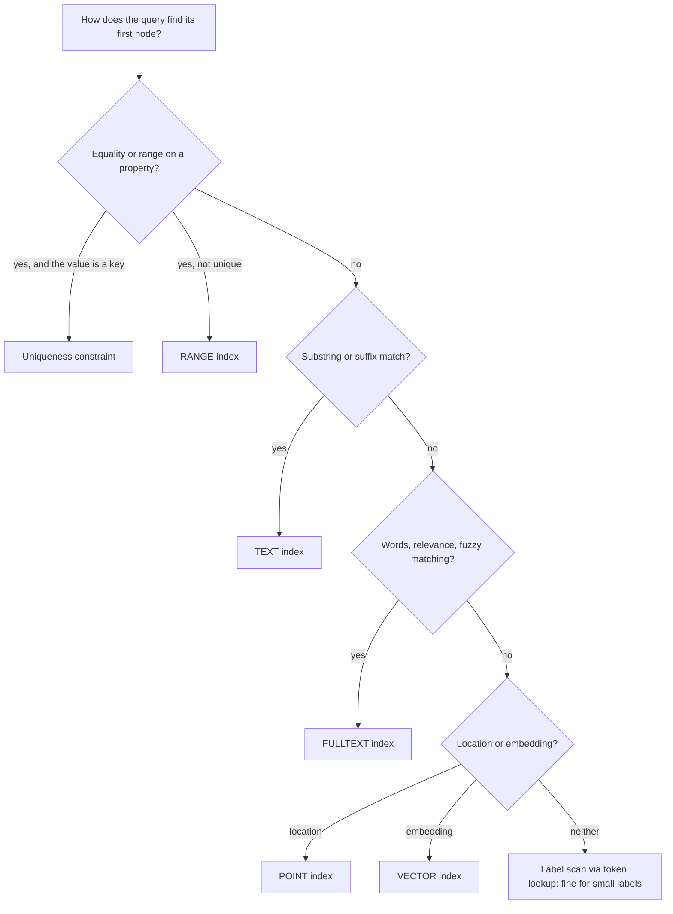

What the starter's indexes do, from `PROFILE` on the seeded graph:

| Query | Operator chosen | Index |
| :--- | :--- | :--- |
| `MATCH (p:Person) WHERE p.city = 'London'` | `NodeIndexSeek` | `RANGE INDEX p:Person(city)` |
| `MATCH (p:Project) WHERE p.name CONTAINS 'Service'` | `NodeIndexContainsScan` | `TEXT INDEX p:Project(name)` |
| `MATCH ()-[w:WORKS_ON]->() WHERE w.since >= 2023` | `DirectedRelationshipIndexSeekByRange` | `RANGE INDEX ()-[w:WORKS_ON(since)]->()` |
| `MATCH (p:Person) WHERE toLower(p.city) = 'london'` | `NodeByLabelScan` + `Filter` | None: a function on the property hides it from the index |
| `MATCH (p:Person) WHERE p.name STARTS WITH 'Ada'` | `NodeByLabelScan` + `Filter` | None: `name` has no index |

Full-text queries use Lucene syntax and return a score:

```cypher
CALL db.index.fulltext.queryNodes('project_search', 'graph OR events') YIELD node, score
RETURN node.slug, round(score, 3) AS score;
```

```text
node.slug, score
"ingest-pipeline", 1.323
"graph-gateway", 0.7
```

`ingest-pipeline` ranks first because its description matches both terms. Index management:

```cypher
SHOW INDEXES YIELD name, type, entityType, labelsOrTypes, properties, state, populationPercent;
DROP INDEX person_city IF EXISTS;
```

Every index costs a write on every change to the indexed property. Index what queries look up, not every property.

### 3.10 Reading Plans with EXPLAIN and PROFILE

`EXPLAIN` shows the plan without running the query. `PROFILE` runs it and adds actual rows and database hits per operator. Read plans bottom-up: the leaf is where the query starts.

```cypher
PROFILE
MATCH (me:Person {handle: 'ada'})-[:FOLLOWS]->(friend:Person)-[:FOLLOWS]->(fof:Person)
WHERE fof <> me AND NOT (me)-[:FOLLOWS]->(fof)
RETURN fof.handle, count(DISTINCT friend) AS mutual
ORDER BY mutual DESC, fof.handle;
```

The plan Neo4j 2026.10 Community produced for the starter graph (`cypher-shell --format verbose`, columns trimmed):

```text
+----------------------+----+--------------------------------------------------------------+------+---------+
| Operator             | Id | Details                                                      | Rows | DB Hits |
+----------------------+----+--------------------------------------------------------------+------+---------+
| +ProduceResults      |  0 | `fof.handle`, mutual                                         |    3 |       0 |
| +Sort                |  1 | mutual DESC, `fof.handle` ASC                                |    3 |       0 |
| +EagerAggregation    |  2 | fof.handle AS `fof.handle`, count(DISTINCT friend) AS mutual |    3 |       4 |
| +Filter              |  3 | NOT anon_1 = anon_0 AND NOT fof = me AND fof:Person          |    4 |       4 |
| +TriadicSelection    |  4 | WHERE NOT (me)--(fof)                                        |    4 |       0 |
| |\                   |    |                                                              |      |         |
| | +Expand(All)       |  5 | (friend)-[anon_1:FOLLOWS]->(fof)                             |    4 |      15 |
| | +Argument          |  6 | friend, anon_0                                               |    2 |       0 |
| +Filter              |  7 | friend:Person                                                |    2 |       2 |
| +Expand(All)         |  8 | (me)-[anon_0:FOLLOWS]->(friend)                              |    2 |       9 |
| +NodeUniqueIndexSeek |  9 | UNIQUE me:Person(handle) WHERE handle = $autostring_0        |    1 |       2 |
+----------------------+----+--------------------------------------------------------------+------+---------+
Total database accesses: 36
```

| Operator | Role | What it tells you |
| :--- | :--- | :--- |
| `NodeUniqueIndexSeek` | Finds ada through the `person_handle` constraint index | The start is cheap: 1 row, 2 hits. Without the constraint this would be a `NodeByLabelScan` |
| `Expand(All)` | Follows `FOLLOWS` relationships from the bound node | Cost tracks the node's degree: index-free adjacency in action |
| `Filter` | Checks labels and predicates that no index answered | High row counts entering a `Filter` mean wasted expansion |
| `TriadicSelection` | Specialised "friend of friend not already a friend" check | The planner recognised the recommendation shape |
| `EagerAggregation` | Groups rows for `count(DISTINCT ...)` | Eager: consumes all input before producing output, so it holds rows in memory |
| `Sort` | Orders the result | Place `LIMIT` after it to let the planner use a Top-N sort |
| `$autostring_0` | The literal `'ada'` was auto-parameterised | The cached plan is reused for other handles |

Other operators worth recognising:

| Operator | Usually means |
| :--- | :--- |
| `AllNodesScan` | No label in the pattern; every node is read |
| `NodeByLabelScan` | Label known, no usable index on the property |
| `CartesianProduct` | Two disconnected patterns. Fine when both sides are single-row seeks (a `SHORTEST` query binding both endpoints plans exactly that); a bug when either side is a scan |
| `Eager` | A write could affect rows a later read sees, so the query is split into phases: memory grows with input size |
| `NodeCountFromCountStore` | A pure count answered from statistics, no data read |
| `VarLengthExpand(All)` / `Repeat(Trail)` | Variable-length or quantified expansion; watch the row counts |
| `ShortestPath`, `StatefulShortestPath` | `SHORTEST` path search: the first for simple patterns, the second when the pattern has per-hop predicates or groups |

Profiling habits: compare **estimated rows** with actual rows (big differences mean stale or missing statistics, often fixed by `CALL db.prepareForReplanning()` after a large load), look for the operator where rows explode, and check that the leaf is an index seek whenever a query starts from a known key.

### 3.11 Pitfalls

| Pitfall | Symptom | Fix |
| :--- | :--- | :--- |
| Counting paths when you mean nodes | Sums and counts too large; `core-lib` counted twice | `WITH DISTINCT d` before aggregating, or `count(DISTINCT d)` |
| Unbounded `-[*]-` or `->+` from an unbound start | Query runs for minutes and exhausts memory (`MemoryLimitExceeded` style errors when a limit is set) | Bind the start with an index lookup, bound the depth (`{1,6}`), filter type and direction |
| Undirected patterns with two unbound ends | Every match appears twice | Give a direction, or `WHERE id ordering` such as `a.handle < b.handle` as the starter's same-city test does |
| `WHERE` placed after `WITH` instead of after `OPTIONAL MATCH` | Rows with no optional match disappear | Put the filter on the `OPTIONAL MATCH` itself |
| Mixing aggregates and non-grouping variables | `42I18 ... non-grouping sub-expression` | Aggregate in a `WITH`, compute afterwards |
| Function wrapped around an indexed property | Plan shows `NodeByLabelScan` + `Filter` instead of an index seek | Store a normalised copy (`cityLower`) and index that, or normalise the parameter instead |
| Expecting `collect` to be sorted | Order changes between runs or versions | `ORDER BY` in the `WITH` before `collect`, or `coll.sort()` |
| `UNWIND` of an empty list | Rows vanish | `OPTIONAL CALL`, or `UNWIND` a `[null]` fallback |
| Reading the plan top-down | Wrong conclusions about where time goes | Read from the leaf up; compare estimated and actual rows |
| Wrong clause order in Cypher 25 | `42I63 ... wrong subclause order` | `ORDER BY`, then `SKIP`/`OFFSET`, then `LIMIT` |
| Trusting `SHORTEST` for weighted routes | "Shortest" route is the one with fewest hops, not lowest cost | Use GDS Dijkstra or A* with a weight property |

### 3.12 Best Practices

- **Start every query from an indexed lookup** when the start is known: it is the difference between one seek and a label scan per call.
- **Constrain type and direction on every hop** (`-[:DEPENDS_ON]->`): relationship groups let the store skip everything else.
- **Bound variable-length patterns** unless the graph guarantees a small closure: an upper bound is a cheap safety net.
- **De-duplicate early** with `WITH DISTINCT` between expansions: fewer rows into the next hop means fewer hits.
- **Use subquery expressions** (`EXISTS { }`, `COUNT { }`, `COLLECT { }`) for per-row checks: they stop at the first match where they can and read better than `OPTIONAL MATCH` + `count`.
- **`LIMIT` right after `ORDER BY`** in the same clause: the planner switches to a Top-N sort.
- **`PROFILE` before and after every index change**: confirm the operator changed; an unused index is pure write overhead.
- **Pin exact answers in tests**, as the starter does: a refactor that changes a recommendation is caught by CI, not by users.

### 3.13 Hands-on Exercise

1. Write a query that lists, for each project, its direct dependencies and its full transitive closure, as two sorted lists.
2. Find the people two `FOLLOWS` hops from `bo` (excluding bo and the people bo already follows), ranked by mutual connections.
3. Find the project with the most transitive dependents and return their number.
4. `PROFILE` query 2 and identify the leaf operator and the index it uses.
5. Write a `SHORTEST 1` query from `dee` to `gus` and return the route.

Expected output: query 1 gives `graph-gateway: direct [auth-service, ui-kit], closure [auth-service, core-lib, ui-kit]` and `ingest-pipeline: direct [core-lib, metrics-agent], closure [core-lib, metrics-agent]`, with `core-lib` having empty lists. Query 2 returns `ada` (1, via dee) and `fay` (1, via eli). Query 3 returns `core-lib` with `5`. Query 4's leaf is `NodeUniqueIndexSeek` on `person_handle`. Query 5 returns `["dee", "ada", "cy", "gus"]`.

Solution: [`exercises/stage3.cypher`](exercises/stage3.cypher).

[Back to top ⤴️](#-table-of-contents)

---

## 4. Stage 4: Transactions, Concurrency & Locking

How Neo4j keeps concurrent writers correct: what a transaction guarantees, which locks it takes, how deadlocks surface and how to write code that survives them. Prerequisite: Stages 1-3. Afterwards you can predict where two writers will block each other and write retry-safe updates.

```mermaid
stateDiagram-v2
    [*] --> Open: BEGIN (explicit) or first statement (auto-commit)
    Open --> Open: reads, writes take write locks
    Open --> Committing: COMMIT
    Committing --> Committed: log entry flushed
    Committing --> RolledBack: constraint violation
    Open --> RolledBack: ROLLBACK, error, timeout, terminated
    Committed --> [*]: locks released
    RolledBack --> [*]: locks released
```

### 4.1 Transactions in Neo4j

Every Cypher statement runs inside a transaction. There are three ways to get one:

| Kind | How | Commit | Retries |
| :--- | :--- | :--- | :--- |
| Auto-commit (implicit) | `cypher-shell` statements, `session.run()`, the Query API | When the result is consumed | None |
| Explicit | `:begin` / `:commit`, `session.beginTransaction()` | When you call commit | None |
| Managed (transaction functions) | `session.executeWrite(tx -> ...)`, `driver.executableQuery(...)` | When the function returns | Automatic on transient errors |

Transactions are ACID. Uncommitted changes live in transaction state on the heap; commit validates constraints, appends to the transaction log and only then makes the changes visible. A constraint violation at commit rolls back the whole transaction, which is why the starter's duplicate tests wrap each attempt in its own inner transaction.

### 4.2 Isolation Level and Read Phenomena

Neo4j runs at **read committed**: a transaction sees only committed data, but data it reads can change before it commits.

| Phenomenon | Possible in Neo4j? | Example |
| :--- | :--- | :--- |
| Dirty read | No | Uncommitted writes are invisible to others |
| Non-repeatable read | Yes | Reading `p.stars` twice in one transaction can return two values |
| Phantom | Yes | A second `MATCH` can see a node another transaction committed meanwhile |
| Lost update | Yes, if you read into a variable and write later | See 4.4 |

Writes take exclusive locks on the nodes and relationships they modify and hold them until commit or rollback. Reads take no locks. Creating or deleting a relationship also locks its end nodes, because their relationship chains change; dense nodes use finer-grained locking so that many concurrent inserts on one supernode do not fully serialise.

### 4.3 Deadlocks and Transient Errors

```mermaid
sequenceDiagram
    participant T1 as Transaction 1
    participant A as Node ada
    participant B as Node bo
    participant T2 as Transaction 2
    T1->>A: SET ada.x (lock ada)
    T2->>B: SET bo.x (lock bo)
    T1->>B: SET bo.y, waits for T2
    T2->>A: SET ada.y, waits for T1
    Note over T1,T2: Cycle detected
    A-->>T2: DeadlockDetected, T2 rolled back
    T1->>B: lock acquired, T1 commits
```

Neo4j detects the wait cycle and aborts one transaction with `Neo.TransientError.Transaction.DeadlockDetected`. Transient errors mean "retry and it will probably work". The drivers' managed transactions retry them with backoff; auto-commit and explicit transactions do not.

Reduce deadlocks by touching shared nodes in a consistent order (sort batch input by key), keeping transactions short, and avoiding `IN CONCURRENT TRANSACTIONS` for `MERGE`s on shared nodes.

### 4.4 Lost Updates and Explicit Locks

A property update that reads and writes the same property in one expression takes the write lock before reading, so concurrent increments are safe:

```cypher
MATCH (p:Project {slug: $slug})
SET p.stars = p.stars + 1;
```

Reading the value into a variable first breaks that guarantee: two transactions can both read 120 and both write 121.

```cypher
// Unsafe under concurrency
MATCH (p:Project {slug: $slug})
WITH p, p.stars AS current
SET p.stars = current + 1;

// Safe: take the lock with a dummy write before reading
MATCH (p:Project {slug: $slug})
SET p._lock = true
WITH p, p.stars AS current
SET p.stars = current + 1
REMOVE p._lock;
```

| Pattern | Locking behaviour |
| :--- | :--- |
| `SET n.x = n.x + 1` | Lock taken before the read: safe |
| `WITH n.x AS v ... SET n.x = v + 1` | Read without lock: lost updates possible |
| Dummy write (`SET n._lock = true`) first | Serialises writers on `n` |
| `MERGE` on a constrained key | The index entry is locked: concurrent `MERGE`s of the same key serialise and the second one matches |
| `MERGE` on an unconstrained property | No index lock: duplicates under concurrency |

### 4.5 Eager Operators, Memory and Timeouts

When a query both reads and writes data that a later part reads again, the planner inserts an `Eager` operator that materialises all rows before writing. On large inputs that means large heap use.

```cypher
// The second MATCH reads the property the SET writes, so the planner must
// finish every SET before the first read: the plan shows
// "Eager | read/set conflict for property: city"
EXPLAIN
MATCH (p:Person)
SET p.city = 'X'
WITH p
MATCH (q:Person {city: 'X'})
RETURN count(q);
```

On eight people this is free; on eight million it holds every row in memory. Rewrite such queries so the read does not depend on the write, or split them into two statements.

Guard rails that every production server should set:

```properties
db.transaction.timeout=60s              # kill runaway transactions
db.lock.acquisition.timeout=10s         # stop waiting for a lock
db.memory.transaction.max=512m          # per-transaction heap limit
dbms.memory.transaction.total.max=4g    # across all transactions
```

A transaction over the memory limit fails with a `MemoryPoolOutOfMemoryError` instead of taking the whole JVM down. Split big writes with `CALL { } IN TRANSACTIONS`.

### 4.6 Observing and Terminating Transactions

```cypher
SHOW TRANSACTIONS
YIELD transactionId, username, currentQuery, elapsedTime, status, activeLockCount
WHERE elapsedTime > duration('PT5S')
RETURN *;

TERMINATE TRANSACTIONS 'neo4j-transaction-31';
```

```mermaid
flowchart LR
    Alert["p99 latency alert"] --> Show["SHOW TRANSACTIONS: long elapsedTime, status Blocked"]
    Show --> Locks["activeLockCount high on one query"]
    Locks --> Term["TERMINATE TRANSACTIONS id"]
    Term --> Fix["Fix: batch it, add timeout, order lock acquisition"]
```

### 4.7 Pitfalls

| Pitfall | Symptom | Fix |
| :--- | :--- | :--- |
| Auto-commit writes from an app | Sporadic `DeadlockDetected` errors reach users | Use managed transactions (`executeWrite`) that retry |
| Side effects inside a retried transaction function | Emails or HTTP calls sent twice | Keep transaction functions pure; do side effects after commit |
| Read-then-write through a variable | Counters lower than the number of increments | `SET n.x = n.x + 1`, or lock first |
| One huge `DETACH DELETE` | `MemoryPoolOutOfMemoryError`, long lock hold | `CALL { } IN TRANSACTIONS OF 1000 ROWS` |
| No transaction timeout | One bad query blocks writers for hours | `db.transaction.timeout` |

### 4.8 Best Practices

- **Managed transactions for application writes**: retries on transient errors come for free.
- **Short transactions, sorted input**: fewer locks held for less time, in a consistent order.
- **Constraints behind every `MERGE` key**: the only safe concurrent upsert.
- **Set timeouts and memory limits**: they turn outages into failed queries.

### 4.9 Hands-on Exercise

Open two `cypher-shell` sessions. In the first run `:begin` and `MATCH (p:Project {slug: 'ui-kit'}) SET p.stars = p.stars + 1;` without committing. In the second, run the same update in auto-commit mode and observe it wait; from a third session run `SHOW TRANSACTIONS` and find the blocked one. Commit the first session and check that `stars` went from 95 to 97. Then reset it with `SET p.stars = 95`.

Expected output: the second session blocks until the first commits; `SHOW TRANSACTIONS` lists it with a status that begins with `Blocked by` and names the first session's transaction id.

[Back to top ⤴️](#-table-of-contents)

---

## 5. Stage 5: Drivers, Import, Migrations & Backup

How applications talk to Neo4j, how large data sets get in, how schema changes are versioned and how to get the data back after a disaster. Prerequisite: Stage 4. Afterwards you can write driver code with correct sessions and retries, bulk-import a data set and run a tested restore.

```mermaid
flowchart LR
    App["Application"] --> Drv["Driver: one per process, thread-safe"]
    Drv --> Pool["Connection pool"]
    Pool -->|"neo4j:// routing table"| Leader["Primary for writes"]
    Pool --> Follower["Secondary for reads"]
    Drv -.-> Sess["Sessions: cheap, not thread-safe, carry bookmarks"]
```

### 5.1 The Driver Model

| Object | Lifetime | Thread-safe | Holds |
| :--- | :--- | :--- | :--- |
| `Driver` | Whole application | Yes | Connection pool, routing table, auth |
| `Session` | One unit of work | No | Bookmarks, target database |
| `Transaction` | One transaction | No | One Bolt connection while open |
| `executeQuery` / `executableQuery` | One call | Yes | Runs a managed transaction for you |

URI schemes: `neo4j://host:7687` uses cluster routing (and works with a single server); `bolt://host:7687` talks to exactly one server. Add `+s` (`neo4j+s://`) for TLS with a CA-signed certificate.

### 5.2 Java Driver

```java
import java.util.Map;
import org.neo4j.driver.AuthTokens;
import org.neo4j.driver.GraphDatabase;
import org.neo4j.driver.QueryConfig;
import org.neo4j.driver.RoutingControl;

public class Recommendations {
    public static void main(String[] args) {
        var uri = System.getenv().getOrDefault("NEO4J_URI", "neo4j://localhost:7687");
        try (var driver = GraphDatabase.driver(uri,
                AuthTokens.basic("neo4j", System.getenv("NEO4J_PASSWORD")))) {
            driver.verifyConnectivity();

            var result = driver.executableQuery("""
                    MATCH (me:Person {handle: $me})-[:FOLLOWS]->(f)-[:FOLLOWS]->(fof:Person)
                    WHERE fof <> me AND NOT (me)-[:FOLLOWS]->(fof)
                    RETURN fof.handle AS handle, count(DISTINCT f) AS mutual
                    ORDER BY mutual DESC, handle
                    """)
                .withParameters(Map.of("me", "ada"))
                .withConfig(QueryConfig.builder()
                    .withDatabase("neo4j")
                    .withRouting(RoutingControl.READ)
                    .build())
                .execute();

            result.records().forEach(r ->
                System.out.printf("%s %d%n", r.get("handle").asString(), r.get("mutual").asInt()));
        }
    }
}
```

| Line | Role |
| :--- | :--- |
| `GraphDatabase.driver(...)` in try-with-resources | One driver per application; closing it closes the pool |
| `verifyConnectivity()` | Fails fast at startup instead of on the first request |
| `executableQuery(...)` | Managed transaction with automatic retries |
| `withDatabase("neo4j")` | Saves a round trip to resolve the home database |
| `RoutingControl.READ` | Sends the query to a secondary in a cluster |

### 5.3 The Same Query in Python, JavaScript and Go

```python
import os
from neo4j import GraphDatabase, RoutingControl

QUERY = """
MATCH (me:Person {handle: $me})-[:FOLLOWS]->(f)-[:FOLLOWS]->(fof:Person)
WHERE fof <> me AND NOT (me)-[:FOLLOWS]->(fof)
RETURN fof.handle AS handle, count(DISTINCT f) AS mutual
ORDER BY mutual DESC, handle
"""

with GraphDatabase.driver("neo4j://localhost:7687",
                          auth=("neo4j", os.environ["NEO4J_PASSWORD"])) as driver:
    records, summary, keys = driver.execute_query(
        QUERY, me="ada", database_="neo4j", routing_=RoutingControl.READ)
    for r in records:
        print(r["handle"], r["mutual"])
```

```javascript
import neo4j from 'neo4j-driver';

const driver = neo4j.driver('neo4j://localhost:7687',
  neo4j.auth.basic('neo4j', process.env.NEO4J_PASSWORD));

const { records } = await driver.executeQuery(
  `MATCH (me:Person {handle: $me})-[:FOLLOWS]->(f)-[:FOLLOWS]->(fof:Person)
   WHERE fof <> me AND NOT (me)-[:FOLLOWS]->(fof)
   RETURN fof.handle AS handle, count(DISTINCT f) AS mutual
   ORDER BY mutual DESC, handle`,
  { me: 'ada' },
  { database: 'neo4j', routing: neo4j.routing.READ });

for (const r of records) console.log(r.get('handle'), r.get('mutual').toNumber());
await driver.close();
```

```go
package main

import (
    "context"
    "fmt"
    "os"

    "github.com/neo4j/neo4j-go-driver/v5/neo4j"
)

func main() {
    ctx := context.Background()
    driver, err := neo4j.NewDriverWithContext("neo4j://localhost:7687",
        neo4j.BasicAuth("neo4j", os.Getenv("NEO4J_PASSWORD"), ""))
    if err != nil {
        panic(err)
    }
    defer driver.Close(ctx)

    result, err := neo4j.ExecuteQuery(ctx, driver,
        `MATCH (me:Person {handle: $me})-[:FOLLOWS]->(f)-[:FOLLOWS]->(fof:Person)
         WHERE fof <> me AND NOT (me)-[:FOLLOWS]->(fof)
         RETURN fof.handle AS handle, count(DISTINCT f) AS mutual
         ORDER BY mutual DESC, handle`,
        map[string]any{"me": "ada"},
        neo4j.EagerResultTransformer,
        neo4j.ExecuteQueryWithDatabase("neo4j"),
        neo4j.ExecuteQueryWithReadersRouting())
    if err != nil {
        panic(err)
    }
    for _, r := range result.Records {
        handle, _ := r.Get("handle")
        mutual, _ := r.Get("mutual")
        fmt.Println(handle, mutual)
    }
}
```

| Concern | Java | Python | JavaScript | Go |
| :--- | :--- | :--- | :--- | :--- |
| Integers | `long` | `int` | `neo4j.Integer` (call `.toNumber()`) unless `disableLosslessIntegers` | `int64` |
| Managed write | `session.executeWrite(tx -> ...)` | `session.execute_write(fn)` | `session.executeWrite(tx => ...)` | `neo4j.ExecuteWrite(ctx, session, fn)` |
| Close | try-with-resources | `with` | `await driver.close()` | `defer driver.Close(ctx)` |

### 5.4 Bulk Import

For an empty database, `neo4j-admin database import` writes store files directly from CSV, bypassing transactions:

```bash
# people.csv:  handle:ID(Person),name,city,joined:date
# follows.csv: :START_ID(Person),:END_ID(Person)
neo4j-admin database import full neo4j \
  --nodes=Person=import/people.csv \
  --relationships=FOLLOWS=import/follows.csv \
  --overwrite-destination=true
```

| Method | Speed | Needs | Use for |
| :--- | :--- | :--- | :--- |
| `neo4j-admin database import full` | Fastest | Empty database, server stopped | Initial loads of millions to billions of rows |
| `LOAD CSV` + `IN TRANSACTIONS` | Medium | Running server, files in `import/` | Incremental loads, small to medium files |
| Driver `UNWIND $rows` batches | Medium | Application code | Streaming from other systems |

Create constraints and indexes after an offline import; the importer does not enforce them.

### 5.5 Schema Migrations

Treat `cypher/` like SQL migrations: numbered, idempotent, applied in order, recorded in the graph.

```mermaid
flowchart LR
    V1["V001 constraints"] --> V2["V002 seed reference data"]
    V2 --> V3["V003 promote city to nodes"]
    V3 --> V4["V004 drop Person.city"]
    V4 --> Log[("(:Migration) nodes record what ran")]
```

Tools that implement this for Neo4j include Neo4j-Migrations (Java, with Spring Boot and Quarkus integrations, plus a CLI) and the Liquibase Neo4j extension. Whichever you choose: one migration per change, `IF NOT EXISTS` on schema statements, batched data changes, and a CI job that applies every migration to an empty database, exactly like the starter's [`scripts/run-tests.sh`](scripts/run-tests.sh).

### 5.6 Backup and Restore

```bash
# Community: offline dump. Stop the database (or the server) first.
neo4j-admin database dump neo4j --to-path=/backups
neo4j-admin database load neo4j --from-path=/backups --overwrite-destination=true

# Enterprise: online, incremental-capable backup from a running server
neo4j-admin database backup neo4j --from=db1.internal:6362 --to-path=/backups
neo4j-admin database restore neo4j --from-path=/backups/neo4j-<timestamp>.backup
```

| Method | Online | Edition | Notes |
| :--- | :--- | :--- | :--- |
| `database dump` / `load` | No | Both | Single file per database; simplest DR for Community |
| `database backup` / `restore` | Yes | Enterprise | Full and differential artefacts, consistency check |
| Volume snapshot | Depends | Both | Only safe with the database stopped or from a backup artefact |

A backup you have never restored is a hope, not a backup: schedule a restore into a scratch server and run your test suite against it.

### 5.7 Pitfalls

| Pitfall | Symptom | Fix |
| :--- | :--- | :--- |
| A new driver per request | Connection storms, slow requests, `ServiceUnavailable` | One driver per process |
| Sharing a session across threads | Random protocol errors | One session per unit of work |
| `bolt://` against a cluster | Writes fail with `NotALeader` after failover | `neo4j://` routing URIs |
| Not consuming results | Connections exhausted, pool timeouts | Use `executeQuery`, or consume/close results |
| JS numbers as integers | Properties stored as `FLOAT` | `neo4j.int(x)` for integer parameters |

### 5.8 Best Practices

- **`executeQuery` for most calls, `executeWrite` for multi-statement units**: both retry transient errors.
- **Pass the database name explicitly**: saves a round trip and avoids surprises when the home database changes.
- **Import offline when the database is new**, online with batches afterwards.
- **Test restores on a schedule**: the only proof that backups work.

### 5.9 Hands-on Exercise

Run the Python or Java example against the starter container, then change it to use a managed write transaction that adds `(:Person {handle: 'ivy'})-[:FOLLOWS]->(:Person {handle: 'ada'})` with `MERGE`, run it twice and confirm only one `ivy` exists. Finally, stop the database, `dump` it, `load` it into a fresh container and run `scripts/run-tests.sh` with `RESET=1` against the original.

Expected output: the recommendation list `eli 2, dee 1, gus 1`; one `ivy` after two runs; a restored database with 21 nodes.

[Back to top ⤴️](#-table-of-contents)

---

## 6. Stage 6: Clustering, Scaling, Tuning & Observability

Running Neo4j for real: how a cluster replicates, how to size memory, what to monitor and how to keep queries fast as data grows. Prerequisite: Stages 4-5. Afterwards you can plan a deployment, size it and know where to look when latency rises.

```mermaid
flowchart TB
    subgraph Cluster["Enterprise cluster: servers host databases"]
        P1["Server 1: neo4j PRIMARY, leader"]
        P2["Server 2: neo4j PRIMARY"]
        P3["Server 3: neo4j PRIMARY"]
        S1["Server 4: neo4j SECONDARY"]
    end
    P1 -->|"Raft log replication"| P2
    P1 -->|"Raft"| P3
    P1 -.->|"async catch-up"| S1
    Client["Driver with neo4j://"] -->|"writes"| P1
    Client -->|"reads"| S1
```

### 6.1 Clustering Model

Enterprise clusters separate **servers** from **databases**. Each database has a topology of primaries (which form a Raft group and accept writes through the leader) and secondaries (asynchronous read replicas).

```cypher
// On the system database
SHOW SERVERS;
ENABLE SERVER '25a7efc7-d063-44b8-bdee-f23357f89f01';
CREATE DATABASE catalog TOPOLOGY 3 PRIMARIES 2 SECONDARIES;
SHOW DATABASES YIELD name, address, role, currentStatus;
```

A write commits when a majority of primaries have it in their Raft log, so three primaries tolerate one failure and five tolerate two. Secondaries scale reads and never vote.

### 6.2 Causal Consistency and Routing

Reads on a secondary can lag. Bookmarks fix that: a session passes the bookmark of its last write, and the server that serves the next read waits until it has applied that transaction. Drivers chain bookmarks within a session automatically and across `executeQuery` calls through the driver's bookmark manager.

```mermaid
sequenceDiagram
    participant App
    participant L as Primary leader
    participant S as Secondary
    App->>L: write, returns bookmark B42
    App->>S: read with bookmark B42
    S->>S: wait until transaction 42 applied
    S-->>App: result that includes the write
```

### 6.3 Scaling Out: Composite Databases

Neo4j does not shard a single graph automatically in the way a key-value store does. To spread data across databases, use **composite databases**: a virtual database that routes subqueries to constituent databases.

```cypher
CREATE COMPOSITE DATABASE community;
CREATE ALIAS community.eu FOR DATABASE community_eu;
CREATE ALIAS community.us FOR DATABASE community_us;

USE community
UNWIND ['community.eu', 'community.us'] AS g
CALL (g) {
  USE graph.byName(g)
  MATCH (p:Person) RETURN count(p) AS people
}
RETURN g, people;
```

Shard along boundaries that queries rarely cross (region, tenant); cross-shard traversals become application-level joins.

### 6.4 Memory Sizing

```bash
neo4j-admin server memory-recommendation --memory=32g
```

| Budget | Setting | Rule of thumb |
| :--- | :--- | :--- |
| Page cache | `server.memory.pagecache.size` | Store size plus growth headroom, so reads come from RAM |
| Heap | `server.memory.heap.initial_size` = `max_size` | 8-31 GB on most servers; equal values avoid resize pauses |
| Transactions | `dbms.memory.transaction.total.max` | Part of the heap reserved for query state |
| OS and other | The rest | Leave 1-2 GB plus native memory for Lucene and the JVM |

### 6.5 Observability

| Signal | Where | Watch for |
| :--- | :--- | :--- |
| Query log (Enterprise) | `db.logs.query.enabled=INFO`, `db.logs.query.threshold=500ms` | Slow queries with their plans and parameters |
| Metrics (Enterprise) | `server.metrics.prometheus.enabled=true` | Page cache hit ratio, transaction rates, Raft lag, GC pauses |
| `debug.log` | `/logs` | Checkpoints, GC warnings, store issues |
| `SHOW TRANSACTIONS` | Cypher | Long-running and blocked work |
| `PROFILE` | Cypher | Plan regressions after data growth |

### 6.6 Supernodes and Data Growth

A node with millions of relationships is fast to reach and slow to expand across all of them. Keep type and direction in every pattern so relationship groups do the filtering, fan out by period or category (2.3), and never return a supernode's full neighbourhood to a client.

### 6.7 Pitfalls

| Pitfall | Symptom | Fix |
| :--- | :--- | :--- |
| Page cache smaller than the hot data set | Latency spikes, high page faults | Size page cache to the store; add RAM |
| Heap above 31 GB | Longer GC pauses from uncompressed object pointers | Stay at or below 31 GB |
| Two primaries | One failure stops all writes | Three or five primaries |
| Reads on secondaries without bookmarks | Users do not see their own writes | Use the driver's bookmark manager |

### 6.8 Best Practices

- **Size page cache first, heap second**: graph traversals are memory-access bound.
- **Odd number of primaries**: majority quorum with the fewest servers.
- **Enable the query log with a threshold**: the cheapest way to find regressions.
- **Load-test with production-shaped degrees**: averages hide supernodes.

### 6.9 Hands-on Exercise

Run `neo4j-admin server memory-recommendation --memory=4g` inside the starter container, apply the recommendation through `NEO4J_server_memory_*` variables, restart and confirm with `SHOW SETTINGS YIELD name, value WHERE name STARTS WITH 'server.memory'`.

Expected output: heap and page cache values equal to the recommendation.

[Back to top ⤴️](#-table-of-contents)

---

## 7. Stage 7: Staff Neo4j Engineer Interview Handbook & Cheatsheet

Questions a staff-level interview for a graph platform or graph-heavy product team asks, with the depth of answer expected. Each answer refers back to the stage that teaches the topic.

### 7.1 Core Concepts (Q1-Q10)

#### Q1. What is a property graph, and how does it differ from RDF?

A property graph stores nodes and relationships, each carrying a map of properties; nodes have zero or more labels and every relationship has exactly one type and a direction. Facts about a connection (a `since` year, a `level`) live on the relationship itself.

RDF stores everything as subject-predicate-object triples. A fact about a relationship needs reification or RDF-star, and identity is global (IRIs), which suits publishing linked data across organisations. Property graphs are more compact for application data and map directly to how developers draw domain models; RDF is stronger for open-world reasoning with ontologies (OWL) and federated SPARQL. Neo4j can import RDF through the neosemantics (n10s) plugin when you need both.

#### Q2. What does "index-free adjacency" mean, and what are its limits?

Each node record points to its first relationship, and each relationship record points to the previous and next relationship of both its end nodes. Expanding from a node follows these pointers instead of looking up a join index, so the cost of a hop depends on the node's degree, not on the size of the database (Stage 1, section 1.4).

The limits: finding the starting node still needs an index or a label scan; a supernode with millions of relationships is expensive to expand fully (relationship groups by type and direction mitigate this); and the benefit applies to traversals, not to aggregations over every node, where a columnar store wins.

#### Q3. When would you not choose Neo4j?

When the workload is dominated by large scans and aggregations with few relationships (analytics over event tables), by simple key-value lookups at very high throughput, or by full-text search as the primary access path. Also when relationships are shallow and fixed (one or two joins on well-indexed keys), where a relational database already performs well and the team knows it.

A useful test: write the five most important queries. If most of them walk a variable number of relationships, rank by connectivity or need path results, a graph fits. If they are `GROUP BY` reports over one big table, it does not.

#### Q4. What is the difference between `CREATE` and `MERGE`, and what are the classic `MERGE` bugs?

`CREATE` writes the pattern unconditionally. `MERGE` matches the whole pattern and creates the whole pattern if no match exists (Stage 2, section 2.6).

The classic bugs: merging on non-key properties (`MERGE (p:Person {handle: $h, name: $n})`) creates duplicates when the name changes; merging a full path (`MERGE (a {k:1})-[:R]->(b {k:2})`) creates a duplicate `a` when only `b` is missing; merging on `null` fails with `22N31`; and merging without a uniqueness constraint creates duplicates under concurrency because two transactions can both see "no match". The fix is a constraint per key, `MERGE` on the key only, `SET` everything else, and nodes before relationships.

#### Q5. What isolation level does Neo4j provide, and what can go wrong?

Read committed. Dirty reads cannot happen; non-repeatable reads and phantoms can. Writes lock the modified entities until commit; reads do not lock (Stage 4, section 4.2).

The practical risk is the lost update when a value is read into a variable and written later in the same transaction. `SET n.x = n.x + 1` is safe because the lock is taken before the read; `WITH n.x AS v ... SET n.x = v + 1` is not. Take a lock first (a dummy write), or keep the read and write in one expression.

#### Q6. How do labels, relationship types and properties differ in query cost?

Labels are stored in the node record (or a small dynamic record) and indexed by the label token lookup index, so `MATCH (n:Label)` is a cheap scan of exactly those nodes. Relationship types are part of the relationship record and, for dense nodes, of the relationship group, so filtering by type during expansion skips other types entirely. Properties live in property records reached through a pointer chain, so filtering on them costs a property read per candidate unless an index answers the predicate.

Design consequence: put the distinctions you traverse by into relationship types (`FOLLOWS` vs `BLOCKS`), the categories you start from into labels, and the values you only display or occasionally filter into properties.

#### Q7. What is the difference between Cypher 5 and Cypher 25, and how do you choose?

They are two language versions served by the same server. Cypher 5 is the stable language of the 5.x line; Cypher 25 adds clauses such as `FILTER`, `LET`, `WHEN`, `NEXT` and `SEARCH`, the `coll.*` functions, the `VECTOR` type and stricter clause ordering, and removes some deprecated forms (see the Versions section).

Choose per database with `db.query.default_language` (Community) or `ALTER DATABASE ... SET DEFAULT LANGUAGE` (Enterprise), and per query with a `CYPHER 5` or `CYPHER 25` prefix. In a migration, pin Cypher 5 by default, run the test suite under Cypher 25, fix the notifications, then flip the default. New projects on current releases should write Cypher 25.

#### Q8. How do quantified path patterns improve on `[*1..5]`?

The old syntax repeats a single relationship. A quantified path pattern repeats a group that can contain labelled nodes, several relationships and a `WHERE` evaluated at every iteration, for example `((a:Project)-[:DEPENDS_ON]->(b:Project) WHERE b.stars < a.stars){1,5}`. Variables inside the group become lists aligned by iteration.

That moves filtering into the expansion, so paths that fail early are pruned instead of being generated and filtered afterwards. It also composes with path selectors (`SHORTEST k`, `ALL SHORTEST`) and match modes. The starter's test `quantified path pattern with a per-hop filter` shows the per-hop filter excluding the `ui-kit` route (Stage 3, section 3.6).

#### Q9. Which constraints are available in Community Edition, and how do you compensate for the rest?

Community supports property uniqueness constraints on nodes and relationships, single or composite. Existence, property type and key constraints are Enterprise-only and fail with `51N27 ... not supported in community edition`.

Compensate in three layers: validate in the application before writing; write only through parameterised, reviewed Cypher (no ad hoc writes in production); and run data tests in CI and on a schedule that assert types and presence, as the starter's [`tests/02_data_test.cypher`](tests/02_data_test.cypher) does with `IS :: DATE NOT NULL`.

#### Q10. Why should you never use `id()` or `elementId()` as an external identifier?

Both identify an element only within one database and only while it exists. Internal ids are reused after deletes, so an id stored in another system can later point at a different node. `elementId()` is the string replacement for the deprecated `id()` and carries the same warning: it can change across store migrations, dump and load, or when a database moves.

Use a business key (`handle`, `slug`, a UUID generated by the application or with `randomUUID()`), back it with a uniqueness constraint, and expose only that.

### 7.5 Staff Cheatsheet

| Need | Neo4j answer | Gotcha |
| :--- | :--- | :--- |
| Idempotent upsert | `MERGE (n:L {key: $k}) SET n += $props` | Needs a uniqueness constraint on `L.key` |
| Connect existing nodes | `MATCH (a {k:$a}), (b {k:$b}) MERGE (a)-[:R]->(b)` | Do not `MERGE` the whole path |
| Batch writes | `UNWIND $rows AS row ...` | 1k-10k rows per call |
| Large writes from Cypher | `CALL (x) { ... } IN TRANSACTIONS OF 1000 ROWS` | Auto-commit only |
| Assert a write fails | `... ON ERROR CONTINUE REPORT STATUS AS s` | Read `s.committed`, `s.errorMessage` |
| Transitive closure | `(a)-[:R]->+(b)` then `DISTINCT b` | Paths multiply; nodes do not |
| Per-hop filter | `((x)-[:R]->(y) WHERE ...){1,5}` | Group variables are lists |
| Shortest route | `SHORTEST 1 (a)-[:R]->+(b)` | Hop count, not weight |
| Per-row top N | `CALL (x) { ... ORDER BY ... LIMIT n }` | Use `OPTIONAL CALL` to keep empty rows |
| Existence / degree | `EXISTS { (n)-[:R]->() }`, `COUNT { (n)-[:R]->() }` | Replace `exists()` / `size()` patterns |
| Substring search | `CREATE TEXT INDEX` + `CONTAINS` | Case-sensitive |
| Relevance search | `CREATE FULLTEXT INDEX` + `db.index.fulltext.queryNodes` | Not usable from `WHERE` |
| Pin the language | `CYPHER 25 MATCH ...` | Default comes from `db.query.default_language` |
| See the plan | `EXPLAIN` / `PROFILE` | Read bottom-up |
| Long-running work | `SHOW TRANSACTIONS`, `TERMINATE TRANSACTIONS 'id'` | Set `db.transaction.timeout` |
| Community backup | `neo4j-admin database dump neo4j --to-path=...` | Database must be stopped |

[Back to top ⤴️](#-table-of-contents)

---

## 🧪 Example Projects

| Project | Builds on | What you practise | Stretch goal |
| --- | --- | --- | --- |
| [Developer-community starter](cypher) (in this repo: `cypher/`, `tests/`, `scripts/run-tests.sh`) | [Stage 1](#1-stage-1-graph-model-architecture--first-queries), [Stage 2](#2-stage-2-data-modelling-writes--constraints), [Stage 3](#3-stage-3-pattern-matching-aggregation-paths--indexes) | Constraints and indexes, idempotent `MERGE` seeds, recommendations, quantified paths, self-checking Cypher tests | Add the reviews model from [2.13](#213-hands-on-exercise) with its own tests |
| Package dependency analyser | [3.6](#36-variable-length-paths-and-quantified-path-patterns), [5.4](#54-bulk-import) | Import a lockfile graph, transitive closure, blast radius of a vulnerable package | Rank packages by how many projects reach them, with GDS PageRank |
| Fraud ring detector | [3.1](#31-pattern-matching-semantics), [3.5](#35-subqueries-exists-count-collect-and-call) | Accounts sharing devices, phones and addresses; cycle detection | Weakly connected components over shared identifiers |
| Movie or product recommender | [3.8](#38-recommendation-and-relational-division-queries), [3.3](#33-aggregation-and-grouping-keys) | Collaborative filtering, scoring by shared ratings | Blend in content similarity with a vector index |
| Access control graph | [2.2](#22-node-relationship-or-property), [3.7](#37-shortest-paths) | Users, groups, roles and resources; "why does Ana have access?" as a path query | Precompute effective permissions and keep them in sync |
| Transit route planner | [3.7](#37-shortest-paths), [2.1](#21-property-types-and-the-type-system) | Stops with `POINT` locations, `SHORTEST` by hops, point indexes | Weighted routes with GDS Dijkstra on travel time |
| Event-driven sync service | [4.3](#43-deadlocks-and-transient-errors), [5.2](#52-java-driver) | Java driver, managed transactions, retry-safe upserts from a message queue | Ordering and deduplication by event id under concurrency |
| Knowledge graph for documentation | [3.9](#39-indexes-kinds-and-how-to-choose), [2.3](#23-intermediate-nodes-and-other-modelling-patterns) | Entities, mentions and full-text search across documents | GraphRAG: vector search to seed nodes, then traversal for context |

## 📝 Cheat Sheets

### CLI and Server Commands

```bash
# Docker
docker run -d --name neo4j -p 7474:7474 -p 7687:7687 \
  -e NEO4J_AUTH=neo4j/change-me-please -v neo4j-data:/data neo4j:2026.10-community
docker exec -it neo4j cypher-shell -u neo4j -p change-me-please

# cypher-shell
cypher-shell -a neo4j://localhost:7687 -u neo4j -d neo4j        # connect
cypher-shell --format plain "MATCH (n) RETURN count(n)"           # one statement
cypher-shell --file migration.cypher                              # run a file
cypher-shell --param 'h => "ada"' 'MATCH (p:Person {handle: $h}) RETURN p'
NEO4J_USERNAME=neo4j NEO4J_PASSWORD=... cypher-shell              # credentials from env

# Server
neo4j start | stop | status | console
neo4j-admin server memory-recommendation --memory=16g
neo4j-admin dbms set-initial-password '<password>'

# Databases
neo4j-admin database dump neo4j --to-path=/backups
neo4j-admin database load neo4j --from-path=/backups --overwrite-destination=true
neo4j-admin database import full neo4j --nodes=Person=people.csv --relationships=FOLLOWS=follows.csv
neo4j-admin database migrate neo4j
neo4j-admin database check neo4j
```

| `cypher-shell` command | Does |
| --- | --- |
| `:help` | List commands |
| `:param name => value`, `:params` | Set and show parameters |
| `:begin`, `:commit`, `:rollback` | Explicit transaction |
| `:use system` | Switch database |
| `:source file.cypher` | Run a file from the session |
| `:exit` | Quit |

### Cypher Quick Reference

| Task | Code |
| --- | --- |
| Find by key | `MATCH (p:Person {handle: $h}) RETURN p` |
| Filter | `MATCH (p:Person) WHERE p.joined >= date('2023-01-01') RETURN p` |
| Create a relationship | `MATCH (a:Person {handle:$a}), (b:Person {handle:$b}) MERGE (a)-[:FOLLOWS]->(b)` |
| Update properties | `SET p += {city: $city}` |
| Delete a node with relationships | `DETACH DELETE p` |
| Optional data | `OPTIONAL MATCH (p)-[:USES]->(s) RETURN p, collect(s)` |
| Group and count | `MATCH (p)-[:KNOWS]->(s) RETURN s.name, count(*) AS n ORDER BY n DESC` |
| Variable-length | `MATCH (a)-[:DEPENDS_ON]->{1,5}(b) RETURN DISTINCT b` |
| Shortest path | `MATCH p = SHORTEST 1 (a)-[:FOLLOWS]->+(b) RETURN p` |
| Existence | `WHERE EXISTS { (p)-[:WORKS_ON]->() }` |
| Degree | `WHERE COUNT { (p)<-[:FOLLOWS]-() } > 10` |
| Ordered list per row | `COLLECT { MATCH ... RETURN x ORDER BY y }` |
| Type check | `WHERE p.joined IS :: DATE` |
| Dynamic label | `MATCH (n:$($label))` |
| Constraint | `CREATE CONSTRAINT c IF NOT EXISTS FOR (p:Person) REQUIRE p.handle IS UNIQUE` |
| Index | `CREATE INDEX i IF NOT EXISTS FOR (p:Person) ON (p.city)` |
| Full-text search | `CALL db.index.fulltext.queryNodes('idx', 'term') YIELD node, score` |
| Batched write | `CALL (r) { ... } IN TRANSACTIONS OF 1000 ROWS` |
| Inspect schema | `SHOW CONSTRAINTS`, `SHOW INDEXES`, `CALL db.schema.visualization()` |

## 📚 Resources

- [Neo4j documentation](https://neo4j.com/docs/)
- [Cypher Manual](https://neo4j.com/docs/cypher-manual/current/)
- [Cypher Cheat Sheet](https://neo4j.com/docs/cypher-cheat-sheet/current/)
- [Operations Manual](https://neo4j.com/docs/operations-manual/current/)
- [Neo4j release notes](https://neo4j.com/release-notes/)
- [Driver manuals: Java, Python, JavaScript, Go, .NET](https://neo4j.com/docs/drivers-apis/)
- [Graph Data Science manual](https://neo4j.com/docs/graph-data-science/current/)
- [Neo4j source repository](https://github.com/neo4j/neo4j)
- [Official Docker image](https://hub.docker.com/_/neo4j)
- [Neo4j developer blog](https://neo4j.com/blog/developer/)

## 🤝 Contributing

Contributions are welcome. Read the [contributing guide](https://github.com/TheLearningHubOrg/.github/blob/main/CONTRIBUTING.md) and the [code of conduct](https://github.com/TheLearningHubOrg/.github/blob/main/CODE_OF_CONDUCT.md) before you open a pull request. Commit messages follow [Conventional Commits](https://www.conventionalcommits.org/), which drive the automated changelog. Run `bash scripts/run-tests.sh` against a scratch server (or `docker build .`) before you push; CI runs the same Cypher tests.

## 📄 License

This project is licensed under the MIT License. See the [LICENSE](LICENSE) file for details.

## 🙏 Acknowledgments

- [Neo4j](https://neo4j.com/) and the Neo4j engineering team
- The [official Neo4j Docker image](https://hub.docker.com/_/neo4j), which the starter, its tests and CI run on
- [GitHub Actions](https://docs.github.com/actions) and [ShellCheck](https://www.shellcheck.net/), used in CI

## 🌐 Connect with me

- [Twitter](https://twitter.com/manthan_ank)
- [LinkedIn](https://www.linkedin.com/in/manthanank)
- [Facebook](https://www.facebook.com/manthanank/)
- [Instagram](https://www.instagram.com/manthan_ank/)
- [YouTube](https://www.youtube.com/@manthanank)
- [GitHub](https://github.com/manthanank)

## ☕ Support

If you like this learning repository and find it useful, consider buying me a coffee or sponsoring me through GitHub Sponsors. Your support helps me keep these guides up to date. Thank you!

[](https://www.buymeacoffee.com/manthanank)

[](https://github.com/sponsors/manthanank)

---

Show your support by 🌟 the repository.
